# LexiNote (Android Java 原生版) 官方使用指南与软件说明书 (v1.5)

> [!NOTE]
> **版本号**：v1.5.0-native (Build 3)  
> **核心定位**：离线优先、安全隐私保护、深度融合大模型语境分析与艾宾浩斯科学记忆体系的原生 Android 智能词汇笔记本。  
> **技术架构**：纯 Java 原生开发，无混合容器开销；内置 ECDICT 本地离线万词词库，支持标准 SQLite/JSON 本地持久化与 TokenDance (词元跳动) 大模型云端驱动。

---

## 一、软件整体架构与核心功能概览

LexiNote v1.5 采用全新的对称平铺底部导航栏，移除了过渡期占位的实验入口，呈现清晰、平衡的四大核心模块：

```mermaid
flowchart TD
    App["LexiNote 客户端 (v1.5 原生版)"]
    
    App --> Tab1["🔍 查询记录 (Query & Assistant)"]
    App --> Tab2["📖 笔记管理 (Notebooks)"]
    App --> Tab3["🔁 复习中心 (Review Hub)"]
    App --> Tab4["⚙️ 设置与数据 (Settings & Data)"]
    
    Tab1 --> T1_1["本地离线词典快速检索 (ECDICT)"]
    Tab1 --> T1_2["多模态拍照取词与语境分析"]
    Tab1 --> T1_3["AI 英语助手长对话与智能提炼命名"]

    Tab2 --> T2_1["主题笔记本分类归档与批处理"]
    Tab2 --> T2_2["无限滚动瀑布流词表 (120+ 真实词条)"]
    Tab2 --> T2_3["仿微信磨砂银灰字母快速滑动条 (A–Z)"]
    Tab2 --> T2_4["仿相册精确到日的时间穿梭轴与浮动卡片"]
    Tab2 --> T2_5["独立锚定下拉菜单 (排序方式 & 释义显示)"]

    Tab3 --> T3_1["SM-2 艾宾浩斯动态自适应记忆排期"]
    Tab3 --> T3_2["跟手横向滑动多计划中枢切换 (阻尼橡皮筋)"]
    Tab3 --> T3_3["看词猜义 / 看义猜词双向考核模式"]
    Tab3 --> T3_4["近 7 天学习动态与掌握度数据流图"]

    Tab4 --> T4_1["TokenDance (词元跳动) OAuth 授权连接"]
    Tab4 --> T4_2["第三方透明充值通道 (资金直达模型服务商)"]
    Tab4 --> T4_3["极速响应与深度思考档位自由调节"]
    Tab4 --> T4_4["加密备份导出与本地全量恢复"]
```



---

## 二、TokenDance（词元跳动）AI 服务连接与充值全流程

### 2.1 充值资金去向与计费模式说明（特别说明）

> [!IMPORTANT]
> **充值资金的去向明确说明**：
> 1. **零加价、零抽成、非盈利客户端**：LexiNote 是一款完全开源、离线优先的本地独立应用程序，软件本身**不收取任何应用购买费、月度订阅费、功能解锁费，更不对 API 调用收取任何中间差价或服务通道佣金**。
> 2. **资金直接进入第三方服务商对公账户**：用户在充值流程中看到的收款方——**“杭州似一科技有限公司”**，为 Watcha 观楂平台及 TokenDance (词元跳动) AI API 网关的合法运营实体。支付通道经由浦发银行商户收银平台清算，直接进入杭州似一科技有限公司企业账户。
> 3. **100% 转化为个人 AI 调用额度**：您充值支付的每一分钱，均 1:1 全额充入您在 TokenDance 的个人账户余额中。
> 4. **按实际 Token 消耗计量扣费**：当您在 LexiNote 中使用 AI 语境解析、复杂语法答疑或图像文字提炼时，TokenDance 平台根据底层真实大语言模型（如 DeepSeek-V3、DeepSeek-R1、Kimi 等）公布的官方 Token 单价精准扣减，账单明细在 TokenDance 官网清晰可查。

---

### 2.2 TokenDance 账号授权登录图文流程

用户无需在移动端繁琐复制粘贴高风险的长串 API Key，LexiNote 原生集成了现代 OAuth 2.0 授权机制：

````carousel

<!-- slide -->

<!-- slide -->

<!-- slide -->

<!-- slide -->

<!-- slide -->

````

1. **进入设置入口**：切换到底部第 4 项【我的】，在顶部“AI 服务 · 词元跳动”卡片中轻触绿色【连接 TokenDance】按钮。
2. **选择登录方式**：应用内调起官方安全授权网关（watcha.cn），用户可根据习惯选择【短信登录】或【密码登录】。
3. **安全验证与隐私保护**：输入中国大陆手机号并获取短信验证码（如上图 3 所示，手机号码与验证凭证均受应用内安全防护与脱敏保护）。
4. **自定义安全额度**：在“授权请求”面板中，默认应用名称为 `LexiNote`。您可自主设定额度上限与重置周期（防止恶意盗刷或突发超量）。
5. **创建专用密钥**：核对回调网关后，点击【授权并创建密钥】。TokenDance 会为本次安装独立派发专属受控令牌，密钥采用 Android Keystore 高度加密隔离存储在设备本地私有目录，不以明文导出。
6. **就绪提示**：授权完成后自动跳转回 LexiNote，状态变更为绿色“已连接，直接开始查词和图片解析”，主按钮变为【重新授权】，表明服务已就绪。

---

### 2.3 TokenDance 账户充值图文流程

TokenDance 充值系统支持小额起充（最低仅需 1 元人民币），用多少充多少：

````carousel

<!-- slide -->

<!-- slide -->

<!-- slide -->

<!-- slide -->

<!-- slide -->

````

1. **输入充值金额**：在“我的”页面轻触【充值】按钮，在“为你的词元跳动账户充值”界面输入金额（例如输入 `1`），点击【创建充值会话】。
2. **确认支付渠道**：界面显示“进行中的充值 ¥1”，点击绿色【支付宝支付 ¥1】按钮唤起支付组件。
3. **银行合规收银台**：页面展示“浦发银行商户收款平台”，收款商户名称明确标注为“**杭州似一科技有限公司**”，核对交易金额 1.00 元（交易单号如上图已作脱敏打码），点击【立即支付】。
4. **支付宝完成付款**：跳转至支付宝收银台，支持花呗优惠、余额宝或银行卡快速扣款。
5. **实时对账校验**：支付完成后浦发银行收款平台显示“支付成功”；返回 LexiNote 应用内，系统自动轮询验证对账接口。
6. **到账通知**：界面提示“上一笔充值 ¥1 已成功到账，可返回继续查词，或继续充值”，您的 TokenDance 账户余额立即增加，查词调用无缝衔接。

---

## 三、四大核心模块详细功能与交互指引

### 3.1 查询记录与 AI 助手（Tab 1）

````carousel

<!-- slide -->

````

- **离线离线秒出（ECDICT 本地引擎）**：
  输入英文单词或短语，无需等待任何网络延迟，直接通过本地内嵌 SQLite 词典即时获取权威词性、音标、核心中英释义。
- **语境专属解读（Context-Aware AI）**：
  在“原句或语境”输入框中粘贴您阅读时遇到的真实上下文段落，大语言模型将结合句式结构、修辞色彩提炼出该单词在具体语境下的地道含义，而非简单罗列泛泛释义。
- **AI 助手对话与“✦ AI”智能命名机制**：
  - 支持向 AI 助手就单词辨析、同义词搭配、例句仿写进行多轮提问；
  - **`✦ AI` 标含义**：会话标题行左侧显示的 `✦ AI` 标代表该标题是由大模型结合首轮对话内容智能总结提炼出的核心主题（`title_source = "ai"`）；若用户手动修改了名称，该标将自动消失并锁定为用户命名。

---

### 3.2 笔记管理与智能索引（Tab 2）

````carousel

<!-- slide -->

<!-- slide -->

<!-- slide -->

````

- **独立下拉菜单控制**：
  - **排序模式下拉单**：点击 `⇅ A-Z ▾` 等排序按钮唤起原生锚定菜单，包含【默认排序】、【按时间降序 (最新)】、【按时间升序 (最早)】、【按字母升序 (A - Z)】、【按字母降序 (Z - A)】、【生词优先 (待学在先)】、【随机乱序】7 种选项，当前生效项带有对勾（`✓`）标记。
  - **释义模式下拉单**：提供【中文释义】、【英文释义】、【隐藏释义】3 种视图，方便用户在浏览时进行自我盲测背诵。
- **微信风格字母快速滑动索引栏**：
  - 切换至字母排序时，右侧呈现细窄字母轴，校准上下边距确保 `↑`、`A`–`Z`、`#` 共 28 个项目完整可见；
  - 手指拖拽滑动时，触摸命中的字母呈现微信标志性的**鲜绿实心圆高亮**（`#07C160`），左侧同步弹出带右侧小尖角的**磨砂银灰对话气泡**（`#C8CBCF`），居中展示纯白加粗大字。
- **相册风格时间穿梭轴**：
  - 切换至时间排序时，索引栏自动切换为垂直时间轴，轴线上附着有深色胶囊徽章（如 `'26.09`、`'26.10`）；
  - 拖拽双向箭头滑块时，浮动深色圆角卡片实时显示具体词条创建的年月日（如 `2026年10月27日`）以及所在总词数进度（如 `第 42 / 120 词`）。

---

### 3.3 复习中心与跟手滑动（Tab 3）

````carousel

<!-- slide -->

````

- **横向跟手滑动手势切换多计划**：
  - 复习页支持管理多个独立的学习计划（如日常沟通、学术阅读、托福短语）；
  - 采用屏幕绝对坐标精准计算触控位移，手指在计划卡片上左右拖拽时，卡片完全**紧贴手指移动**；
  - 达到两端边界时具备舒适的**物理阻尼橡皮筋效果**；拖拽超过 16% 屏幕宽度后释放，触发平滑的滑出并快速切换至下一个计划，上方分页指示圆点同步平滑位移。
- **一体化计划中枢卡**：
  - 彻底合并冗余的计划说明卡与今日任务卡，单卡内聚合：计划运行状态（如 `🟢 待学 15`）、计划名称、归属笔记本、学习频次、今日核心指标（待学习、新词配额、复习配额）、完成百分比进度条与复习模式选择；
  - 提供【看词猜义】（识记意念、翻转评级）与【看义猜词】（看中文回忆拼写）两种专业复习机制。
- **近 7 天学习动态监控**：
  - 实时归纳打卡天数、新学词汇量、复习通过次数以及历史累计答题总数，形成可持续的学习正反馈。

---

### 3.4 设置与数据安全（Tab 4）

````carousel

````

- **AI 推理速度与深度思维调节**：
  - 提供交互式滑块调节大模型推理档位：
    - **极速响应**：关闭深度思考 CoT，毫秒级直接输出答案，极度省流且适合快速查词；
    - **标准思考**：平衡推理深度与耗时，适合长难句复杂语法分析；
    - **深度推理**：开启完整思维链分析，适合专业考研、GRE 难词溯源与辨析。
- **数据自主与离线备份保障**：
  - 支持将全部词汇、标签、复习排期事件与会话完整打包导出为带 CRC32 校验的 `ZIP 2.2` 文件或纯文本 `JSON 1.1` 备份；
  - 更换手机或重装系统时，通过【恢复数据备份】一键秒级还原，无任何数据壁垒。
