# LexiNote (Android Java 原生版) 官方使用指南与软件说明书 (v1.5 全功能完整版)

> [!NOTE]
> **版本号**：v1.5.0-native (Build 3)  
> **核心定位**：离线优先、安全隐私保护、深度融合大模型语境分析与艾宾浩斯科学记忆体系的高性能原生 Android 智能词汇笔记与复习中心。  
> **技术架构**：纯 Java 原生开发，无 WebView/Hybrid 混合容器开销；内置 ECDICT 万词离线词库与 Sherpa-ONNX 离线发音引擎；数据采用 SQLite 与结构化 JSON 双轨本地存储；支持 TokenDance (词元跳动) 大模型云端无感鉴权驱动。

---

## 一、系统整体架构与四大核心模块

LexiNote v1.5 对底部导航栏进行了等宽重构（移除了过渡期占位的实验入口），形成清晰对称、各占 25% 屏幕宽度的四大核心模块：

```mermaid
flowchart TD
    App["LexiNote 客户端 (v1.5 原生版)"]
    
    App --> Tab1["🔍 查询记录 (Query & Assistant)"]
    App --> Tab2["📖 笔记管理 (Notebooks)"]
    App --> Tab3["🔁 复习中心 (Review Hub)"]
    App --> Tab4["⚙️ 设置与数据 (Settings & Data)"]
    
    Tab1 --> T1_1["本地离线词典毫秒检索 (ECDICT)"]
    Tab1 --> T1_2["多模态拍照/相册取词与局部涂抹裁剪"]
    Tab1 --> T1_3["AI 深度语境解读与例句生成"]
    Tab1 --> T1_4["AI 英语助手长对话 (支持智能命名与会话抽屉)"]
    Tab1 --> T1_5["一键存入笔记本与最近查询记录"]

    Tab2 --> T2_1["主题笔记本书架视图与新建/管理"]
    Tab2 --> T2_2["无限滚动词汇瀑布流 (120+ 真实测试词库)"]
    Tab2 --> T2_3["仿微信磨砂银灰字母快速滑动条 (A–Z)"]
    Tab2 --> T2_4["仿相册精确到日的时间穿梭轴与浮动卡片"]
    Tab2 --> T2_5["独立锚定下拉菜单 (7 种排序模式 & 3 种释义视图)"]
    Tab2 --> T2_6["词条详情展开、多重义项批注与自定义标签 (#学术、#GRE)"]
    Tab2 --> T2_7["批量管理模式 (批量迁移笔记本、打标签、删除)"]

    Tab3 --> T3_1["SM-2 艾宾浩斯自适应记忆排期算法"]
    Tab3 --> T3_2["跟手横向滑动多计划切换 (物理阻尼橡皮筋效果)"]
    Tab3 --> T3_3["整合型计划中枢卡 (待学/新词/复习指标与进度条)"]
    Tab3 --> T3_4["【看词猜义】卡片翻转与艾宾浩斯评级 (再次/困难/简单)"]
    Tab3 --> T3_5["【看义猜词】拼写盲测回忆交互"]
    Tab3 --> T3_6["近 7 天学习动态与掌握度数据流图"]

    Tab4 --> T4_1["TokenDance (词元跳动) OAuth 2.0 免密授权连接"]
    Tab4 --> T4_2["第三方透明充值通道 (资金直达模型服务商似一科技)"]
    Tab4 --> T4_3["极速响应与深度思考档位自由调节 (毫秒级输出 / CoT 思维链)"]
    Tab4 --> T4_4["语音引擎配置 (Sherpa-ONNX 离线语音包 / 系统 TTS)"]
    Tab4 --> T4_5["全量离线数据加密备份导出 (ZIP 2.2 / JSON 1.1) 与秒级还原"]
```



---

## 二、TokenDance（词元跳动）AI 服务连接与充值全流程

### 2.1 充值资金去向与计费模式说明（特别说明）

> [!IMPORTANT]
> **充值资金去向的明确说明**：
> 1. **零加价、零抽成、非盈利客户端**：LexiNote 是一款完全开源、离线优先的本地独立应用程序，软件本身**不收取任何应用购买费、月度订阅费、功能解锁费，更不对 API 调用收取任何中间差价或通道佣金**。
> 2. **资金直接进入第三方服务商对公账户**：用户在充值流程中看到的收款方——**“杭州似一科技有限公司”**，为 Watcha 观楂平台及 TokenDance (词元跳动) AI API 网关的合法商业运营实体。支付通道经由浦发银行商户收银平台清算，直接进入杭州似一科技有限公司企业账户。
> 3. **100% 转化为个人 AI 调用额度**：您充值支付的每一分钱，均 1:1 全额充入您在 TokenDance 的个人账户余额中。
> 4. **按实际 Token 消耗计量扣费**：当您在 LexiNote 中使用 AI 语境解析、语法答疑或图像文字提炼时，TokenDance 平台根据底层真实大语言模型（如 DeepSeek-V3、DeepSeek-R1、Kimi 等）公布的官方 Token 单价精准扣减，账单明细在 TokenDance 官网清晰可查。

---

### 2.2 TokenDance 账号授权登录图文流程

用户无需在移动端繁琐复制粘贴高风险的长串 API Key，LexiNote 原生集成了现代 OAuth 2.0 授权机制：

````carousel

<!-- slide -->

<!-- slide -->

<!-- slide -->

<!-- slide -->

<!-- slide -->

````

1. **进入设置入口**：切换到底部第 4 项【我的】，在顶部“AI 服务 · 词元跳动”卡片中轻触绿色【连接 TokenDance】按钮。
2. **选择登录方式**：应用内调起官方安全授权网关（watcha.cn），用户可根据习惯选择【短信登录】或【密码登录】。
3. **安全验证与隐私保护**：输入中国大陆手机号并获取短信验证码（如上图 3 所示，手机号码与验证凭证均受应用内安全防护与脱敏打码保护）。
4. **自定义安全额度**：在“授权请求”面板中，默认应用名称为 `LexiNote`。您可自主设定额度上限与重置周期（防止恶意盗刷或突发超量）。
5. **创建专用密钥**：核对回调网关后，点击【授权并创建密钥】。TokenDance 会为本次安装独立派发专属受控令牌，密钥采用 Android Keystore 高度加密隔离存储在设备本地私有目录，不以明文导出。
6. **就绪提示**：授权完成后自动跳转回 LexiNote，状态变更为绿色“已连接，直接开始查词和图片解析”，主按钮变为【重新授权】，表明服务已就绪。

---

### 2.3 TokenDance 账户充值图文流程

TokenDance 充值系统支持小额起充（最低仅需 1 元人民币），用多少充多少：

````carousel

<!-- slide -->

<!-- slide -->

<!-- slide -->

<!-- slide -->

<!-- slide -->

````

1. **输入充值金额**：在“我的”页面轻触【充值】按钮，在“为你的词元跳动账户充值”界面输入金额（例如输入 `1`），点击【创建充值会话】。
2. **确认支付渠道**：界面显示“进行中的充值 ¥1”，点击绿色【支付宝支付 ¥1】按钮唤起支付组件。
3. **银行合规收银台**：页面展示“浦发银行商户收款平台”，收款商户名称明确标注为“**杭州似一科技有限公司**”，核对交易金额 1.00 元（交易单号如上图已作脱敏打码），点击【立即支付】。
4. **支付宝完成付款**：跳转至支付宝收银台，支持花呗优惠、余额宝或银行卡快速扣款。
5. **实时对账校验**：支付完成后浦发银行收款平台显示“支付成功”；返回 LexiNote 应用内，系统自动轮询验证对账接口。
6. **到账通知**：界面提示“上一笔充值 ¥1 已成功到账，可返回继续查词，或继续充值”，您的 TokenDance 账户余额立即增加，查词调用无缝衔接。

---

## 三、四大核心模块详细功能与交互指引

### 3.1 查询记录与 AI 助手（Tab 1）

````carousel

<!-- slide -->

<!-- slide -->

<!-- slide -->

<!-- slide -->

<!-- slide -->

<!-- slide -->

````

#### 1. 文本查询与双核释义
- **ECDICT 离线词库秒查**：输入单词后，内置本地离线数据库毫秒级返回国际音标、词性分类、高频中文释义与考试大纲标签（CET4/CET6/GRE/IELTS），在断网飞行模式下依然功能健全。
- **语境专属解读（Context-Aware AI）**：在“原句或语境”输入框中粘贴您阅读时遇到的真实上下文段落，大模型自动进行句法剖析，并在结果卡片中打上 `✦ AI` 标签，给出贴合当前语境的精准语义与仿写例句。
- **语音朗读**：轻触喇叭图标可播放真人级单词发音，支持本地 Sherpa-ONNX 离线语音包与系统 TTS 自由切换。

#### 2. 多模态拍照/相册取词
- **图像编辑器（ImageEditorDialog）**：支持调起相机拍照或从相册选择含有英文的图片，内置全屏编辑器可进行旋转、裁切，并支持手指直接在屏幕上“画框涂抹”目标生词区域。
- **OCR 提炼与图文互印**：系统精准定位框选文本，自动提取并填入查询卡片，实现即拍即查。

#### 3. 词汇入库与历史追溯
- **一键存入笔记本**：在查询结果页点击【存入笔记】，弹出笔记本选择器，支持存入已有笔记本或即时新建笔记本，词条自动归档。
- **最近查询历史抽屉**：点击顶栏【最近查询】胶囊，展开历史抽屉，随时一键重温此前查询过的词汇。

#### 4. AI 英语助手与“✦ AI”标说明
- **多轮深入探讨**：针对复杂语法、长难句结构、近义词微细辨析发起连贯多轮追问。
- **会话抽屉与智能命名机制**：
  - 点击右上角对话抽屉图标可查看全部历史会话；
  - **`✦ AI` 标含义**：会话标题行左侧显示的 `✦ AI` 标代表该标题是由大模型结合首轮对话内容智能总结提炼出的核心主题（`title_source = "ai"`）；若用户点击【修改名称】手动编辑了标题，系统记录为用户自定义命名，该 `✦ AI` 标会自动隐去以避免被大模型二次覆盖。

---

### 3.2 笔记管理与智能索引（Tab 2）

````carousel

<!-- slide -->

<!-- slide -->

<!-- slide -->

<!-- slide -->

<!-- slide -->

<!-- slide -->

<!-- slide -->

<!-- slide -->

````

#### 1. 笔记本组织架构
- **书架视图**：支持按项目、学科、阅读主题建立多本笔记本（如“工作沟通”、“常用短语”、“学术阅读”），每本笔记独立统计词汇总数，可指定默认笔记本。
- **新建与编辑**：可自由定义笔记本名称、描述说明以及专属主题色标。

#### 2. 独立锚定下拉菜单
- **排序下拉菜单**：从筛选抽屉中彻底独立为顶部常用按钮，点击唤起原生锚定菜单：
  1. **默认排序**：保留最初入库顺序；
  2. **按时间降序 (最新)**：新词在前，适合近期复盘；
  3. **按时间升序 (最早)**：老词在前，温故知新；
  4. **按字母升序 (A - Z)**：标准英汉词典字典序；
  5. **按字母降序 (Z - A)**：倒字典序；
  6. **生词优先 (待学在先)**：按记忆掌握度等级（0~5 级）升序排列，未背熟词条置顶；
  7. **随机乱序**：彻底打乱次序，避免位置记忆干扰。
- **释义模式下拉菜单**：
  1. **中文释义**：默认显示简明释义；
  2. **英文释义**：显示纯英文解释，培养英语思维；
  3. **隐藏释义**：隐去释义文字，仅展示单词与词性标签，便于刷词盲测。
- **紧凑/平铺模式切换**：一键在“紧凑模式”（单行高密度）与“平铺详细”（展开例句与多重释义）之间切换。

#### 3. 极速滑动双索引引擎
- **微信风格字母滑动栏**：在 A-Z / Z-A 模式下，右侧细窄索引栏完整呈现 28 个项目（`↑`、`A`–`Z`、`#`）。手指滑动触碰字母触发触觉震动反馈，被触碰字母显示**鲜绿色圆形高亮**（`#07C160`），左侧浮动**磨砂银灰带右尖角对话气泡**（`#C8CBCF`），大字清晰呈现。
- **相册风格时间穿梭轴**：在时间排序模式下，滑动条切换为相册时间轴，附着 `'26.09`、`'26.10` 等深色年月胶囊徽章；滑动滑块时，浮动深色圆角卡片实时显示具体入库日期（如 `2026年10月27日`）与序号定位。

#### 4. 词条详情、标签与批量管理
- **详情与自定义标签**：展开词条卡片可查阅完整典型例句、多重义项与批注笔记；支持为词条打上任意自定义标签（如 `#学术`、`#GRE`、`#高频短语`），顶部筛选栏可按标签快速交集检索。
- **批量管理功能**：点击顶部【批量管理】进入多选模式，支持一键全选/反选，提供【批量移动至笔记本】、【批量添加/移除标签】与【批量删除】。

---

### 3.3 复习中心与科学记忆体系（Tab 3）

````carousel

<!-- slide -->

<!-- slide -->

<!-- slide -->

````

#### 1. 艾宾浩斯自适应复习算法（SM-2 进阶版）
- 根据用户每一次答题评级（再次、困难、简单），动态调整词汇的复习间隔因子（EF）与下一次复习时间戳；
- 词汇掌握度分为 6 个层级（0~5 级），从“待学习”逐步跃迁至“掌握中”直至“已掌握”永久记忆。

#### 2. 多计划跟手左右滑动切换
- **手势阻尼与流畅物理动画**：
  支持用户同时保持多个独立复习计划（如考研词汇、商务英语等）。手指在计划卡片上左右滑动时，卡片采用绝对物理坐标**紧贴手指位移**；
- 到达最左或最右端时具备自然的**橡皮筋阻尼拉伸效果**；滑动超过判定阈值释放后，卡片平滑滑出并无缝切换至下一个计划，上方指示圆点同步跃迁。

#### 3. 整合型计划中枢卡
- 合并了原分散的计划信息与学习任务，单卡内集合：
  - 计划状态（如 `🟢 待学 15`）、计划名称、归属笔记本、打卡排期；
  - 今日任务核心指标：**待学习总量**、**今日新词配额**、**今日复习配额**；
  - 学习进度百分比进度条与完成比例指示；
  - 复习模式切换选择与醒目的【开启今日复习】主按钮。
- **休息日与超额加练**：非打卡日或今日配额已完成时，卡片呈现温和提示，并提供【⚡ 今天也学一组】随时灵活加练。

#### 4. 沉浸式复习考核模式
- **看词猜义（Flashcard 翻转模式）**：
  - **正面**：展示英文单词与音标，支持轻触发音，用户在脑海中回忆中文释义；
  - **点击翻转**：卡片平滑翻转，展示中文释义、语境例句与词性；
  - **艾宾浩斯三档评级**：
    1. **再次**：未记住或遗忘，该卡片立刻进入今日错题重循环，并在近期重新考核；
    2. **困难**：勉强想起，间隔因子适度下调，巩固复习频次；
    3. **简单**：轻松掌握，间隔天数按记忆曲线大幅拉长。
- **看义猜词（拼写回忆模式）**：
  展示中文含义与词性，用户在输入框中回忆拼写英文单词，系统自动比对并判定正误。
- **后台计时保护**：应用切入后台或息屏时复习计时器自动挂起，重新点亮进入时无缝恢复，精确统计真实专注时长。

#### 5. 7 天学习动态监控
- 统计卡片直观汇总展示：**打卡天数**、**新学词汇量**、**复习通过次数**、**历史累计答题总数**。

---

### 3.4 设置与数据安全（Tab 4）

````carousel

````

#### 1. AI 推理速度与深度思维调节
- **推理档位交互滑块**：
  - **极速响应**：关闭深度思考 CoT，毫秒级直接输出答案，极度省流且适合快速查词；
  - **标准思考**：平衡推理深度与耗时，适合长难句复杂语法分析；
  - **深度推理**：开启完整思维链分析，适合专业考研、GRE 难词溯源与辨析。
- **服务状态与连通性**：提供【一键测试服务连接】，实时核验 TokenDance 或自定义 API 网关的响应延迟。

#### 2. 外观、发音与交互定制
- **主题模式**：支持跟随系统、浅色模式与护眼深色暗黑模式；
- **发音引擎切换**：支持离线 Sherpa-ONNX 神经网络语音引擎与 Android 系统 TTS，并提供英音（UK）与美音（US）选择。

#### 3. 数据自主与备份迁移规范
- **全量离线归属**：所有词库、自定义笔记、复习事件排期、掌握度记录均存储于本地应用沙盒数据库中，不上传任何私有第三方云端。
- **标准化数据导出与恢复**：
  - 支持导出为带 CRC32 完整性校验的 `ZIP 2.2` 文件，或可人类阅读的 `JSON 1.1` 备份文件；
  - **API Key 安全隔离**：依循严格的安全防泄漏标准，API 密钥存储在硬件支持的 Android Keystore 隔离区中，**绝不会打包导出在任何备份文件中**，保障个人凭证安全。

---

## 四、功能完整性与离线可用性矩阵 (Feature & Offline Matrix)

| 功能模块 | 具体特性 | 离线可用性 | 依赖外部服务 |
| :--- | :--- | :---: | :--- |
| **查询记录** | ECDICT 本地词典快速查词、音标与释义 | 🟢 100% 离线可用 | 无 |
| **查询记录** | Sherpa-ONNX 神经网络离线真人语音朗读 | 🟢 100% 离线可用 | 本地语音模型 |
| **查询记录** | AI 深度语境解读、智能长难句辨析 | 🌐 需网络连接 | TokenDance / 大模型 API |
| **查询记录** | 拍照取词、本地相册图像裁剪与生词涂抹 | 🟢 100% 离线可用 | 本地相机与图像编辑器 |
| **查询记录** | AI 英语助手多轮对话与 `✦ AI` 自动命名 | 🌐 需网络连接 | TokenDance / 大模型 API |
| **查询记录** | 一键保存词汇到笔记本、最近查询历史抽屉 | 🟢 100% 离线可用 | 本地 SQLite |
| **笔记管理** | 主题笔记本创建、编辑、归档与默认设置 | 🟢 100% 离线可用 | 本地 SQLite |
| **笔记管理** | 120+ 词汇无限滚动瀑布流加载 | 🟢 100% 离线可用 | 本地 SQLite |
| **笔记管理** | 独立 7 种排序模式 (最新/最早/A-Z/Z-A/生词/随机) | 🟢 100% 离线可用 | 本地排序引擎 |
| **笔记管理** | 独立 3 种释义视图 (中文释义/英文释义/隐藏释义) | 🟢 100% 离线可用 | 本地渲染 |
| **笔记管理** | 微信风格字母滑动索引条 (带磨砂气泡与绿色高亮) | 🟢 100% 离线可用 | 原生 Custom View |
| **笔记管理** | 相册风格时间穿梭轴 (精确到日年月日浮动卡片) | 🟢 100% 离线可用 | 原生 Custom View |
| **笔记管理** | 词条详情多重释义编辑、例句与自定义标签 | 🟢 100% 离线可用 | 本地 SQLite |
| **笔记管理** | 批量多选、批量移动笔记本、批量打标签与删除 | 🟢 100% 离线可用 | 本地 SQLite |
| **复习中心** | SM-2 艾宾浩斯动态自适应记忆排期与掌握度评级 | 🟢 100% 离线可用 | 本地算法引擎 |
| **复习中心** | 跟手左右滑动多计划切换 (含物理橡皮筋阻尼) | 🟢 100% 离线可用 | 原生 Custom Layout |
| **复习中心** | 一体化复习计划中枢卡与今日指标监控 | 🟢 100% 离线可用 | 本地 SQLite |
| **复习中心** | 【看词猜义】双面翻转卡片与三档评级考核 | 🟢 100% 离线可用 | 本地交互 |
| **复习中心** | 【看义猜词】拼写回忆与盲测输入 | 🟢 100% 离线可用 | 本地交互 |
| **复习中心** | 近 7 天打卡动态统计与学习流监控 | 🟢 100% 离线可用 | 本地 SQLite |
| **设置与数据** | TokenDance OAuth 免密授权登录与银行通道充值 | 🌐 需网络连接 | 观楂 Watcha / 浦发银行收银台 |
| **设置与数据** | AI 推理档位调节 (极速响应 vs 深度思考 CoT) | 🟢 100% 离线生效 | 保存至本地设置 |
| **设置与数据** | 全量数据备份打包导出 (ZIP 2.2 / JSON 1.1) 与恢复 | 🟢 100% 离线可用 | 本地文件 I/O |

---

## 五、常见问题解答 (FAQ)

### Q1: 在没有网络或飞行模式下，我可以使用 LexiNote 的哪些功能？
**答**：LexiNote 采用离线优先架构设计，在完全无网络的环境下：
- **查词**：内置的万词级 ECDICT 本地词典完整可用，可秒级查出音标、词性及中文含义；
- **发音**：Sherpa-ONNX 离线语音引擎与系统 TTS 均可在离线状态下朗读单词；
- **笔记**：创建/管理笔记本、浏览词表、A-Z 与时间轴快速检索、编辑释义与标签、批量管理全部 100% 正常使用；
- **复习**：完整的艾宾浩斯复习排期、看词猜义翻卡、看义猜词拼写打卡全部在本地执行并记录；
- **仅以下功能需要联网**：调用云端大模型的语境解读、AI 英语助手长对话，以及 TokenDance 账号授权与充值。

### Q2: 为什么充值时收款商户显示为“杭州似一科技有限公司”？
**答**：LexiNote 是一款完全开源的客户端软件，自身不设立收费账户，也不从 API 调用中抽取任何利润。应用接入的大模型网关服务由“杭州似一科技有限公司”（Watcha 观楂平台 / TokenDance 词元跳动运营方）提供。用户充值的款项全额直接进入杭州似一科技有限公司在浦发银行的对公商户账户，并 100% 转化为用户个人的 Token 余额，按实际消耗的模型 Token 计费。

### Q3: 充值完成后，如果 LexiNote 界面没有立即更新余额怎么办？
**答**：浦发银行收款成功后，系统会自动向 TokenDance 网关同步对账。如果在应用内因网络抖动未即时显示，可轻触充值界面的【检查到账状态】按钮触发主动对账，或点击右上角【刷新】重新拉取最新余额；亦可随时在电脑浏览器登录 `watcha.cn` 查看个人资产明细。

### Q4: 换新手机后，如何将原手机中的词汇与复习进度完整迁移？
**答**：
1. 在旧手机中进入【我的】→【数据与存储】→ 点击【导出数据备份】，选择保存 `ZIP 2.2` 或 `JSON` 备份文件到手机存储或微信/网盘；
2. 在新手机上安装 LexiNote，进入【我的】→ 点击【恢复数据备份】，选取刚才导出的备份文件；
3. 系统将秒级自动重建所有笔记本、词条关联、自定义标签、复习排期进度以及历史做题记录。
