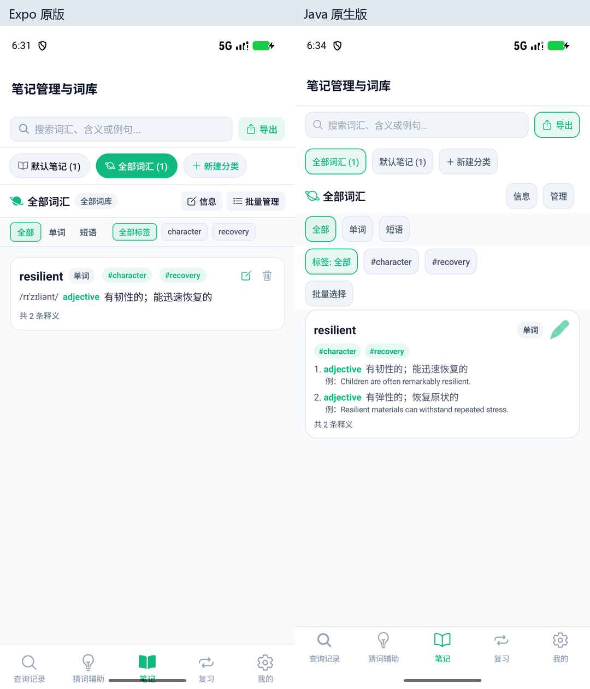
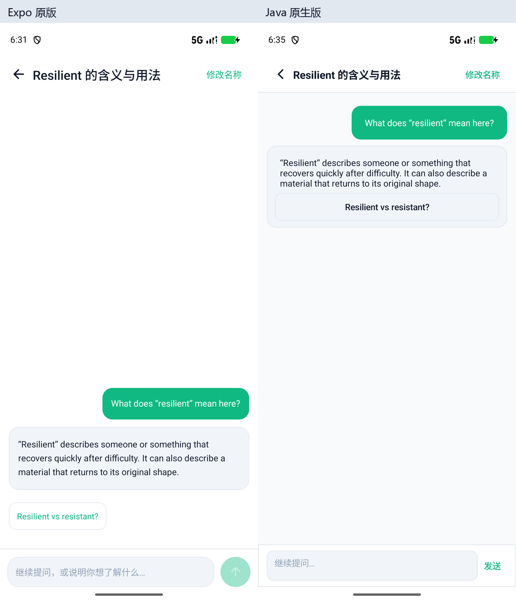

# 两版实际体验与画面对比

日期：2026-10-27。结论：主要查询、词条、笔记和答疑流程已经接近；画面与操作方式仍不是一比一。明显的实际缺口是TokenDance账户流程、超过200条消息的界面访问，以及大备份容量。不能凭“Java原生”判断运行速度更快，本轮没有性能基准测试。

## 实拍条件与数据

- 同一Pixel_9a / Android API37 / 1080×2424 / 420dpi / 系统字号1.0；应用浅色、标准字号、舒适密度、绿色强调色。
- Expo使用Release APK，Java使用Debug APK；本轮不以两种构建产物的包体或启动耗时作性能结论。
- Expo源码基线d465b969；Java代码基线5c6eb5c。两版实际安装APK的SHA256分别与本地APK一致：Expo `e58b41ec7a44ba2c8888a1b12cb860606af75426b7aa2a039ccd1dac5d936722`；Java `2812836e35af4b276d9fe5b12503b2c6d042de854d59c7acb4da04dbe7664f18`。
- 进一步核对Expo APK中bundle与本地生成bundle一致，source map里的五个Tab、InfoView、AssistantMessages均与当前源码一致。因此没有用陈旧安装包冒充当前源码。
- 空态对空态；含数据页面使用同一[fixture JSON](../ui-parity/fixture.json)/[ZIP](../ui-parity/fixture.zip)：1个resilient词条、2条双语释义及例句、相同标签、1个保存会话/2条消息、1条历史。设置页均选择TokenDance，Key为空；没有本次API调用。
- 原版通过真实恢复入口导入，拍完后用恢复前快照回退，并核对词汇/历史/保存及临时会话恢复到空态。Java拍摄前保存私有library和供应商配置，拍完逐字节恢复；恢复前后SHA256一致。未把私有供应商文件复制到仓库。
- 共16组/32张真实截图；`reference/`与`native/`为原始PNG及accessibility XML，`pairs/`仅等比缩放、左右拼接及加外部标题。没有改写画面内容，不提供容易误导的“相似度百分比”。状态栏时间、键盘自动大写等状态不视作业务布局差异。

## 画面上直接能看到的差别

| 页面 | 实际观察 | 对体验的影响 |
| --- | --- | --- |
| 首页/图文查询 | 分段、查询区、已保存/临时会话的顺序和大小已接近。Expo卡片阴影更明显；Java更扁平，字重、图标、间距不同 | 切换版本不需要重新学习首页结构；细节仍能辨认出不同实现 |
| 笔记 | Expo以单行摘要呈现词条；Java展开更多释义和例句，类型与标签筛选另占行，编辑图标风格不同 | Java内容更直观，但同屏可见词条数量更少、滚动更多；两版均有批量管理 |
| 词条 | 词头、音标、编号释义、灰底双语块及底部操作已接近。Java字距/行距略大，头部AI补充/已保存位置和原版不同 | 主要信息一致；Java当前屏幕露出的下一条内容略少 |
| 整理 | Expo直接点击带绿色边框的释义/例句块；Java使用“显示本义/例句”复选框、中英切换及就地编辑按钮 | 是相同业务目的下的不同操作，不宜称作已完全还原原版交互 |
| 助手 | 同一短会话中，Expo消息靠近底部输入框，Java消息从顶部开始；追问建议在Expo气泡外、Java放在气泡内；发送图标/文字不同 | Java短会话顶部聚集、下方留白更多。键盘弹起时两版输入框均可见；聊天视觉对齐仍需改进 |
| 复习 | 卡片顺序和三列统计接近。Expo更紧凑，Java模式卡和按钮尺寸/对齐不同 | 原版点击卡片翻面；Java点击“显示答案”后评级。两版都不是需要打字作答的拼写测验 |
| 设置/模型 | Expo首屏含TokenDance连接、账户、充值、调用记录；Java首屏是通用服务概览。Expo预设按钮直接铺开，Java经“切换供应商”菜单选择，表单一直显示地址与模型ID | Java手动配置更直接，账户集成体验仍明显不同；高级设置截图按对应区域对齐滚动，不是同一滚动偏移 |
| 底栏/基础控件 | Java底栏给系统手势区留出更明显空间；复选框、开关、部分按钮采用Android原生样式 | 导航语义接近，但阴影、按钮、文字度量及底部空白没有像素对齐 |

## 仍会真正影响使用的功能差别

| 场景 | Expo原版 | Java原生版 |
| --- | --- | --- |
| TokenDance | 有登录授权、账户/密钥、充值及调用记录入口 | 通用接口/手动Key可用，尚无专属账户流程 |
| 超长会话 | FlatList可向上浏览完整已存消息 | 当前仅显示最近200条，没有加载更早消息入口；旧消息仍在本地数据/备份中 |
| 备份容量 | ZIP上限50MiB | 总量最高16MiB、JSON最高4MiB，且随应用堆缩小；大词库/大量原图更容易触及限制 |
| 字段批注 | 显式表单选择字段及目标片段 | 支持划词后“批注选中文字”，预填字段和片段 |
| 图片编辑 | 编辑完成后用变换图替换附件 | 原图与派生图分别保留，有明确的“保留原图/使用当前图”；派生图最长边1600px |
| Markdown表格 | 当前自定义Markdown组件没有表格解析，竖线表格按普通文本处理 | 有可横滑的原生表格；不代表完整CommonMark/HTML支持 |
| 澄清候选 | 澄清选项直接发送；普通追问建议只填入 | 当前候选填写输入框后还需发送；返回首页确认查询的约束仍保留 |

源码复核依据：Expo `AssistantMessages.tsx`、`services/storage/conversations.ts`、`review.tsx`、`notebooks.tsx`、`AnnotationModal.tsx`、`RegionDrawer.tsx`、`TokenDanceCard.tsx`、`backupFormat.ts`；Java `AssistantTimeline`/`AssistantUi`、`ReviewUi`、`NotebookUi`、`ImageEditorDialog`、`ProviderSettingsUi`和`BackupArchive`。

此前“原版拼写测验未迁移”和“拖拽排序未迁移”的表述不准确：两版当前源码都未提供打字拼写或拖拽排序。已更正当前迁移表，并给旧报告加了更新索引。

## 对照图

[五页面总览：上Expo、下Java](overview-latest.png)。以下每组均为左Expo、右Java：

| 空态与基础页面 | 相同数据页面 |
| --- | --- |
| [首页空态](pairs/home-empty.png) | [首页含数据](pairs/home.png) |
| [图片查询](pairs/query-image.png) | [词条查看](pairs/result.png) |
| [图文查询](pairs/query-mixed.png) | [就地整理](pairs/organize.png) |
| [猜词](pairs/guess.png) | [笔记含数据](pairs/notebooks.png) |
| [笔记空态](pairs/notebooks-empty.png) | [复习准备](pairs/review.png) |
| [复习空态](pairs/review-empty.png) | [相同短会话](pairs/assistant.png) |
| [助手空态](pairs/assistant-empty.png) | [助手键盘弹起](pairs/assistant-keyboard.png) |
| [设置首屏](pairs/settings.png) | [高级模型设置](pairs/model-editor.png) |

## 边界与下一步

本轮是只读功能核对与实际屏幕审视，没有修改应用业务代码，也没有重新声称101项旧验收用例在本轮执行。没有比较所有弹窗、深色、大字体、其他分辨率、滚动流畅度、内存/耗电或真机相机。

若优先贴近原版使用习惯，建议先处理Java助手短会话的底部对齐、笔记卡片的紧凑摘要、整理控件的视觉统一；功能优先级则是加载更早消息、TokenDance账户、再扩大备份容量。

可用 `python docs/ui-parity-2026-10-27/compose.py` 从已保留原图重生成拼图。重新拍摄时先保存测试数据，按以上空态/fixture分别导入，两版切换同一预设和主题，用adb accessibility树定位并截屏，结束后还原数据。初次冷启动的系统服务尚未就绪曾造成automation失败，待boot完成后重新采集；不归因于应用缺陷。
