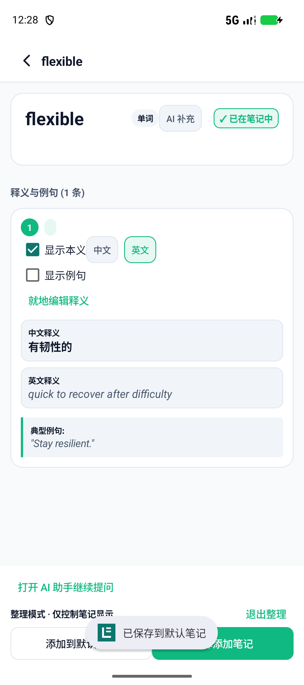
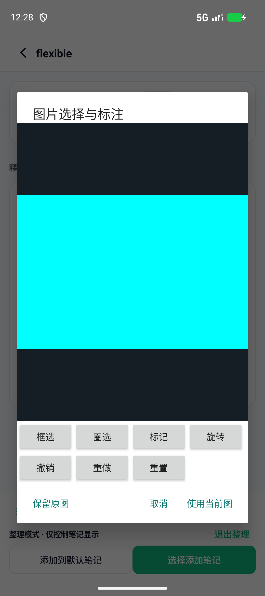
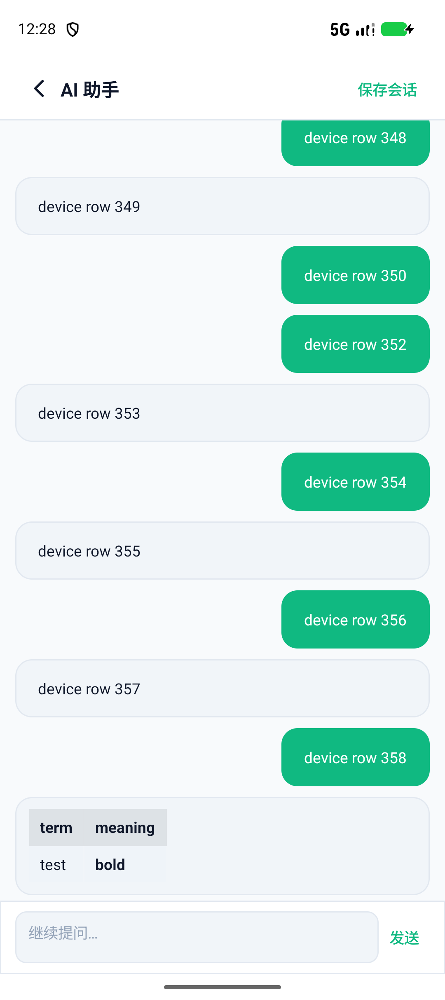
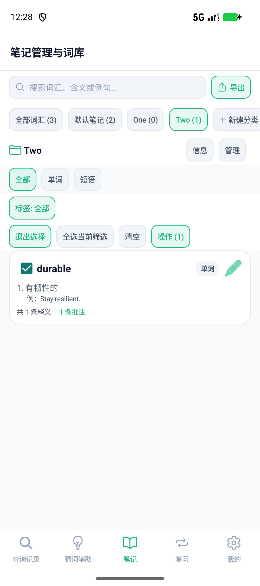

# 四组功能迁移验收

日期：2026-10-26。在独立 Java 仓库 `codex/android-native-java` 的 b76b137 基础上实现。原 Expo 仓库保持 d465b969、工作区无修改。所有本轮实现/审查 Subagent 使用 gpt-6-luna / high。

## 行为与使用入口

| 选定功能 | 已实现行为 |
| --- | --- |
| 查询与词条 | 高级设置中开启自动记录，选择默认笔记及显示字段。仅成功的新词结果自动保存；本地命中、一般聊天、未确认/无效提案不保存，同一结果幂等。词条页 AI 补充校验目标、合并并去重；整理模式逐义选择、中英二选一、例句显示和就地编辑，完整共享实体不会因显示选择而删字段。 |
| 图片 | 系统相机 EXTRA_OUTPUT 写完整文件，成功回传 Intent 为空也可接收；图库/相机原始字节保留。编辑器框选、自由圈选、独立画笔、旋转、双指移动缩放、撤销/重做/重置。原图与派生图独立存储、重开和 ZIP 打包，保留区域与编辑状态；移除附件后重开不恢复旧图。 |
| AI 助手 | 后台 SSE，逐步显示 action JSON 的顶层 message 文本；流结束后再验证/应用最终动作，中断/截断拒绝执行。可取消/重试，普通 JSON 兼容。后台 AI 命名保护手动命名、删除和备份恢复。ListView 回收最近200条用户/助手消息，以消息ID和偏移恢复阅读位置；原生可横滑表格、行内样式及代码块。 |
| 笔记 | 标签快捷筛选、选择当前筛选结果、批量移动/复制引用/移除引用/全局删除确认。保留目标笔记已有显示配置，筛选变化清理隐藏选择；移除引用不删其他笔记共享实体。筛选结果按显示配置导出 Markdown。打开词汇完整内容时长按定义/例句/来源等字段划词，选择“批注选中文字”；保留字段、原文和释义ID，可编辑删除批注。 |

## 验证结果

- `gradlew --offline testDebugUnitTest lintDebug assembleDebug`：构建成功，80项测试、0失败、0错误；Lint 0错误、10警告（未抑制）。两个入口的 `assembleDebugAndroidTest` 分别构建成功。[构建日志](features-gradle.txt)
- Pixel 9a / emulator-5554 / Android API37：新增7组设备检查通过，包含实际 QueryUi/AssistantUi 接入的模拟 HTTPS SSE 与自动命名。[新增日志](features-device.txt)
- 同设备原有10组回归检查通过，覆盖五入口、布局尺寸、离线查询、提案确认、复习、Keystore、裁剪、原子持久化/回退及损坏恢复。[回归日志](features-regression-smoke.txt)
- 原 Expo 仓库只读复查 `npx --no-install expo lint` 和 `npx --no-install tsc --noEmit` 均退出0。
- 测试先复现并修复：SSE内容误当HTTP信封、旋转区域/画笔导出、目标笔记显示覆盖、筛选隐藏选择、确认本地词触发自动记录、ZIP将 `source_images` 显示布尔值当图片数组、移除附件后重开恢复旧图。检查代码及离线用例随源码提交。

## 设备截图

截图来自原生应用与离线测试数据，已逐张检查布局、内容和固定底栏。沿用上一轮五入口布局，本轮未重新声明与 Expo 像素一致。相机编辑图是1800×1200的纯色测试照片。

| 查询整理 | 图片编辑 |
| --- | --- |
|  |  |

| 长会话表格与固定输入框 | 笔记批量选择 |
| --- | --- |
|  |  |

## 复跑

先启动 Android 模拟器，再安装 Debug APK。以下 PowerShell 参数引号必须保留：

```powershell
.\gradlew.bat --offline testDebugUnitTest lintDebug assembleDebug assembleDebugAndroidTest '-PdeviceRunner=com.lexinote.nativeapp.FeatureInstrumentation'
adb install -r app/build/outputs/apk/debug/app-debug.apk
adb install -r app/build/outputs/apk/androidTest/debug/app-debug-androidTest.apk
adb shell am instrument -w com.lexinote.nativeapp.test/com.lexinote.nativeapp.FeatureInstrumentation
adb pull /sdcard/Android/data/com.lexinote.nativeapp/files/feature-verification/. docs/verification/features-screens
.\gradlew.bat --offline assembleDebugAndroidTest
adb install -r app/build/outputs/apk/androidTest/debug/app-debug-androidTest.apk
adb shell am instrument -w com.lexinote.nativeapp.test/com.lexinote.nativeapp.SmokeInstrumentation
```

测试结束恢复原有本地数据，测试凭据使用隔离存储。不使用真实 API Key 或付费模型请求。

## 已知验证边界

全分辨率相机流程以1800×1200文件模拟外部相机写入并调用空 Intent 成功回传，未实际按物理相机快门。原图保留完整分辨率，编辑预览/派生图最长边1600px；圈选保存多边形路径并以外接矩形裁剪，画笔叠加在派生图上。撤销历史属于当前编辑器会话，重开恢复最终编辑状态。

最近200条消息用于可见时间线，历史消息仍保留在会话和备份中。表格支持竖线/转义/行内代码与Markdown样式、横向滚动，不等同完整HTML/CommonMark渲染器。Android8.0最低版本和真实供应商尚未实机验收；备份仍最高16MB总量/4MB文本并受设备堆限制。
