# 页面布局与实际使用舒适度评估

日期：2026-10-28  
评估版本：原生 Java 版 b35bd58；本轮不修改应用代码。

## 一、整体结论

**标准宽度下基本可用，局部阅读、触控和小屏适配仍需优化。整体问题是空间分配不均，而不是所有页面都应加宽边框或统一变“松”。**

- **描边粗细：** 当前常用描边为1dp，浅色卡片边框较轻，没有全局加粗的必要。描边、屏幕页边距和正文内边距应分开处理。
- **左右留白：** 笔记列表外侧约14dp、卡内12dp，词条正文距屏幕约26dp，整体合理；“词库完整内容”弹窗的普通正文却几乎贴着弹窗内沿，属于局部缺少内边距。
- **布局密度：** 笔记页顶部操作层偏多，服务配置动作集中；首页选填上下文和复习卡又占用较大空间。全局改成更紧或更松都会影响另一部分页面。
- **优先处理：** 弹窗正文留白、窄屏标题栏与模式切换、助手浮动按钮、大字号覆盖范围、小触控区。
- **已确认可保留：** 底部五入口位置稳定，标准字号下复习设置可完整看到，助手气泡内边距较充分，键盘展开后输入与发送仍可见。模型选择弹窗的半行项目可通过滚动访问，不按“内容丢失”处理。

本报告归纳 **12组观察**：4项行为/适配异常、4项有测量支撑的舒适度问题、4项设计取舍建议。它们不等同于12项功能故障。优先级为本项目的改进建议，不是正式用户研究评分。

## 二、类型划分与摘要

| 类型 | 包含观察 | 摘要解释 |
| --- | --- | --- |
| A．留白与间距 | LC01–03，共3组 | 弹窗正文偏贴边；首页和复习则留白偏多。需要局部调整，不应统一压缩间距。 |
| B．密度与层级 | LC04–05，共2组 | 笔记顶部控件堆叠，配置页初次使用时动作较多；主要影响浏览效率和操作顺序理解。 |
| C．触控与发现 | LC06–07，共2组 | 部分触控区较矮，横向内容的后续选项不易发现；控件可操作，但手持点选和查找成本较高。 |
| D．适配与设置一致性 | LC08–10，共3组 | 大字号未覆盖助手正文；密度设置未改变布局；窄屏大字号出现实际裁切和挤压。 |
| E．阅读与遮挡 | LC11–12，共2组 | 浮动按钮压在消息上，浅色绿色文字/白字绿底对比偏低，影响阅读和动作辨识。 |

证据性质：**行为确认**＝设备操作后观察到实际变化或异常；**测量观察**＝截图、可访问性边界及源码支持；**设计建议**＝基于已见画面的舒适度判断，仍适合让真实用户进一步验证。

| 编号 | 优先级 | 观察 | 证据性质 |
| --- | --- | --- | --- |
| LC01 | 高 | 词条弹窗普通正文缺少左右留白，字段之间较紧 | 测量观察 |
| LC02 | 中 | 首页选填上下文默认占据较多首屏空间 | 设计建议 |
| LC03 | 中 | 复习卡内容靠上，卡内及底部动作前留白较大 | 设计建议 |
| LC04 | 中 | 笔记顶部多层控件持续占用可视区 | 设计建议 |
| LC05 | 中 | 服务配置初次使用时动作集中，操作顺序还可简化 | 设计建议 |
| LC06 | 高 | 筛选、日期等部分触控区明显小于48dp | 测量观察 |
| LC07 | 中 | 分类、标签和复习范围的横向后续内容提示较弱 | 测量观察 |
| LC08 | 高 | 应用“大”字号未放大助手Markdown正文与表格 | 行为确认 |
| LC09 | 中 | “舒适/紧凑”只改变设置值，未改变本次词库布局 | 行为确认 |
| LC10 | 高 | 360dp大字号裁切最近查询计数；320dp模式文字挤压 | 行为确认 |
| LC11 | 高 | 键盘展开时“回到最新消息”与消息气泡重叠 | 行为确认 |
| LC12 | 中 | 默认绿色与白色的文字对比度约2.54:1 | 测量观察 |

## 三、关键画面与问题说明

### A．留白与间距：弹窗需要增加，首页和复习需要重新分配

| 词条弹窗：正文贴边 | 独立查询结果：正文留白较充分 |
| --- | --- |
| 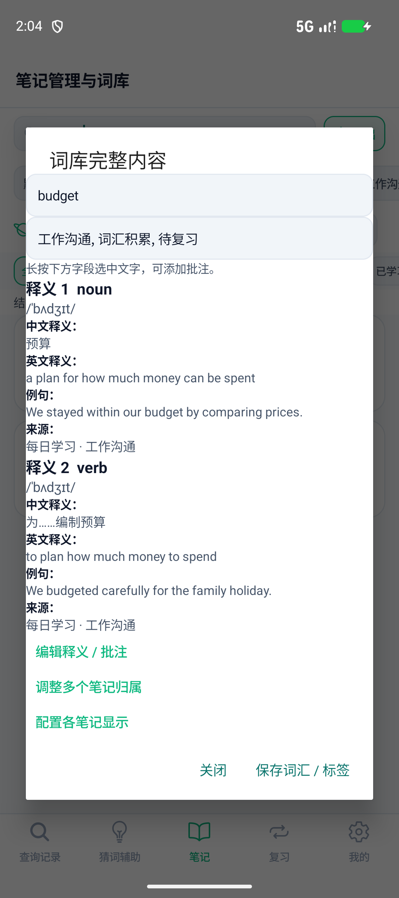 | 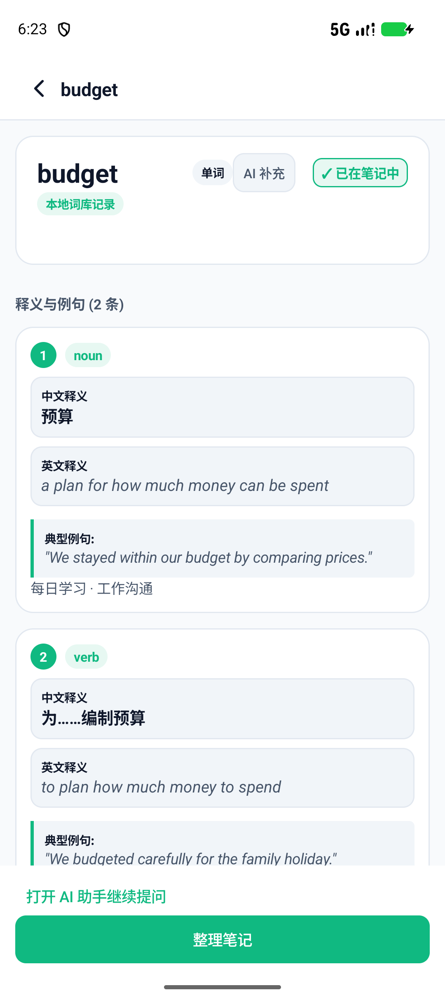 |
| [查看本轮原图](layout-comfort/screens/03-detail-standard.png) | [查看同版本前次原图](usage-fixes/manual/screens/08-local-budget.png) |

**LC01：词条弹窗是最明确的留白问题。** 普通释义、来源、提示文字从x=70px开始，与自定义内容区域左边基本重合；标题从x=133px开始，二者的对齐线相差约24dp。两条释义中的“字段标题→内容→下一字段”直接排列，条目之间缺少分组间隔。大字号和360dp场景也能看到同一问题：[大字号](layout-comfort/screens/19-detail-large.png)、[360dp大字号](layout-comfort/screens/26-detail-360dp-large.png)。

建议给自定义弹窗正文统一16–24dp内边距，字段标题与值保持小间隔，释义之间使用更明显的间隔或分隔。数值是本项目建议，可通过改版截图再比较。应保留滚动，避免为了塞进首屏而缩小正文。NotebookUi.detail的box/ScrollView未设置内容padding，与画面一致；独立结果页已有分组留白，可以作为内部参考。右图引用前次同一b35bd58版本取证，未混称本轮新拍。

| 首页查询区 | 复习卡揭晓前 |
| --- | --- |
| 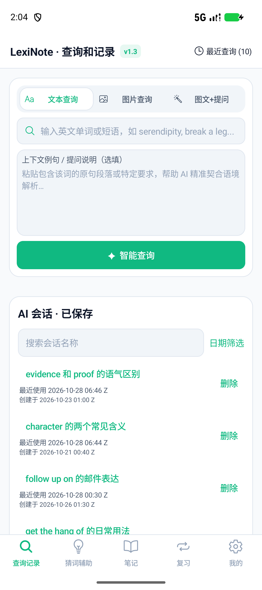 | 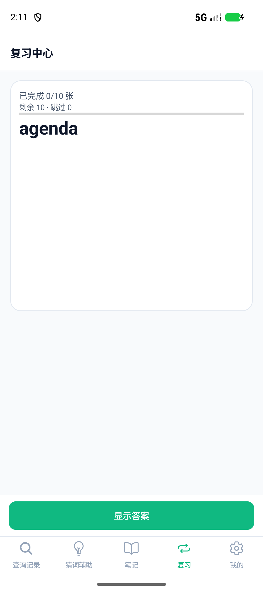 |

**LC02：首页对选填内容投入的默认空间较大。** 查询卡固定312dp，本设备实测819px，占顶栏下、底部导航上可用区约43%；加上卡后30dp间隔，接近47%。只查一个词时，选填上下文仍占据大块空白。建议默认缩小或折叠选填区，聚焦后展开，同时让三种查询模式遵守一致的收放规则，保留模式切换的稳定性。当前设计有利于放图片和长上下文，不属于控件失效。

**LC03：复习卡的视觉重心偏上。** 最小卡高360dp，短词及进度集中在顶部；卡片底端到“显示答案”按钮顶端约779px，即297dp。长释义需要增长空间，但短词场景显得上下脱节。建议让短内容适度居中、设置更合理的最小高度或让评级区靠近卡片，同时保留底部固定操作的便利。[揭晓后画面](layout-comfort/screens/10-review-answer-standard.png)也可用于比较两种状态。

### B．密度与层级：优先减少重复操作层，不继续压缩正文

| 笔记列表 | 默认TokenDance配置 |
| --- | --- |
| 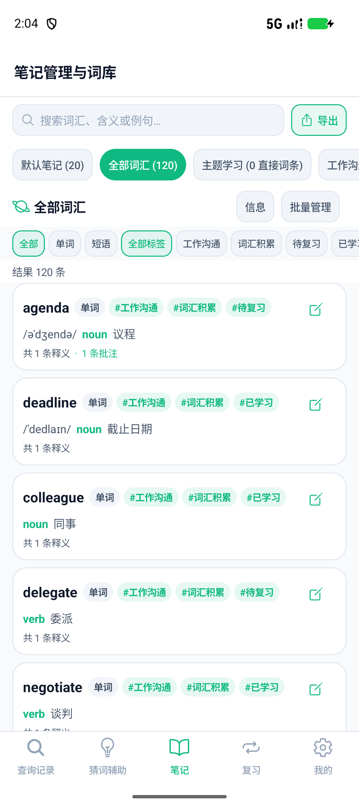 | 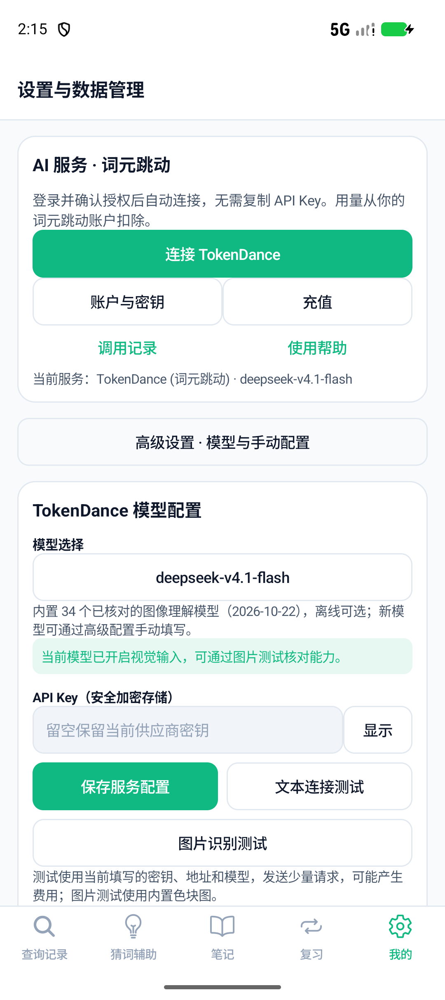 |

**LC04：笔记列表顶部的层级偏多。** 搜索、笔记分类、当前分类与管理、类型与标签、结果数依次堆叠。从顶栏下缘到首张词卡约557px，约占此页可用内容区29%。列表卡片自身有12dp内边距和8dp卡间隔，并没有普遍贴边。建议优先合并管理入口、按需展开筛选，让主要词条更早出现；单张词卡不宜再挤紧。

**LC05：服务配置的动作较集中。** 默认首屏同时可见连接、账户与密钥、充值、调用记录、帮助、高级设置、模型选择、显示密钥、保存及两种测试，约11个动作。连接按钮已有主色区分，这是优点；授权前后的步骤、常用与诊断操作仍可更清楚。相邻描边按钮、卡片和输入框使用相似视觉重量，也增加分框感。

建议按“连接→选择模型→正常使用”组织默认路径，账户入口保留，手动密钥与连接诊断按需展开；高级配置仍保留完整能力，不删除兼容方式。此项是信息架构和视觉取舍建议。[高级配置](layout-comfort/screens/15-settings-expanded-standard.png)、[手动表单](layout-comfort/screens/16-settings-manual-standard.png)。

### C．触控与发现：可点击不代表点选足够轻松

本机420dpi，1dp=2.625px。下面是实际UI边界测量，而非按缩略图估算：

| 控件 | 实测高度 | 判断 |
| --- | --- | --- |
| 首页“日期筛选” | 约20.2dp | 小文字点击区偏矮，建议扩大透明触控区域 |
| 笔记“全部/单词/短语” | 约30.1dp | 短边较小，连续切换时较容易点偏 |
| 首页查询模式、笔记搜索框 | 约36.2dp | 视觉可读，但触控高度仍可增加 |
| 复习“10词/组” | 40dp | 比筛选芯片更宽松，仍可完善有效点击区域 |
| 底部导航 | 62dp | 整体区域充分，可保留 |

**LC06：优先扩大高频小控件的有效触区。** Android建议交互区域至少48×48dp；可保留较小的视觉控件，用内边距或父容器扩大触区，并避免相邻区域重叠。[Android Views交互区域指南](https://developer.android.com/guide/topics/ui/accessibility/views/apps-views?hl=en)、[Google触控尺寸说明](https://support.google.com/accessibility/android/answer/7101858?hl=en)。

笔记编辑图标虽为32×32dp，但周围词卡也能打开同一详情，因此不把图标尺寸单独判为无法点选。上述日期、筛选按钮的父级没有同等动作，也未发现TouchDelegate扩展；这是更应优先处理的部分。本轮没有真实手持误触率数据。

**LC07：横向隐藏内容的发现性不足。** 分类、标签、复习范围可横滑，后续项目通常只露出部分边缘，滚动条关闭。大字号时[下一分类仅露出一小段](layout-comfort/screens/18-notebook-large-comfortable.png)，当前激活的远端标签也可能不在眼前。建议增加边缘渐隐、“更多”或当前筛选摘要，优先保持已选项可见。[复习范围](layout-comfort/screens/08-review-overview-standard.png)存在相同取舍。模型选择的纵向列表有明确续列和滚动行为，[半行项目](layout-comfort/screens/14-model-picker-standard.png)不等于不可访问。

### D．适配与设置一致性：存在实际异常

| 助手：标准字号 | 助手：应用“大”字号 |
| --- | --- |
| 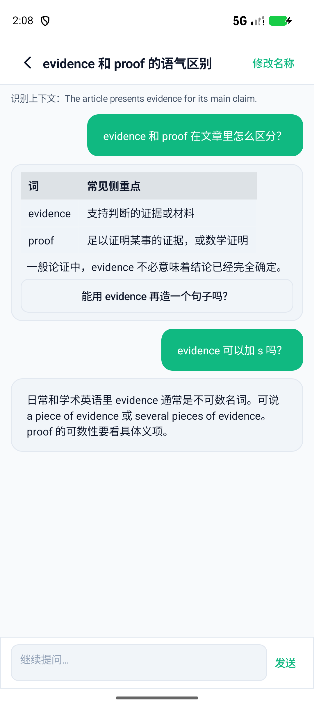 | 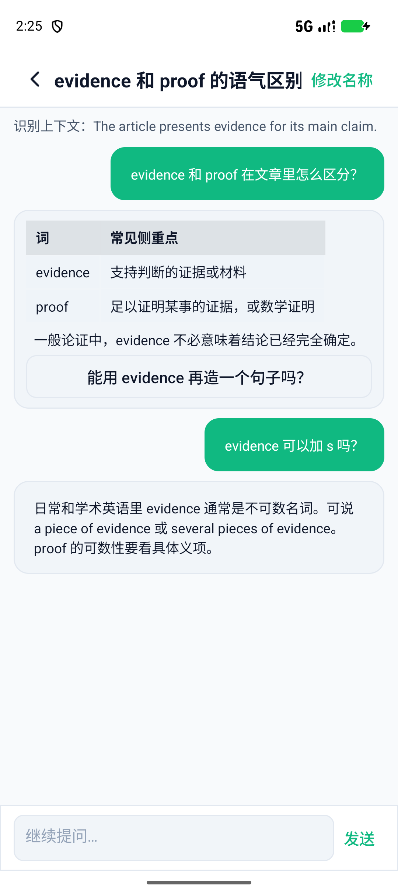 |

**LC08：字号设置没有统一作用于阅读内容。** “修改名称”和识别上下文变大，但同一proof单元格在两图中均为199×87px，表格及Markdown答复未随应用字号放大。MarkdownView直接创建TextView，未应用MainActivity.scale；当前应用大字号系数为1.15。建议统一正文、表格与代码字号基准，再允许标题和辅助文字有相对层级。这一结论针对应用内字号，不泛化为系统字体缩放无效。

**LC09：显示密度切换缺少实际反馈。** 在同为大字号、浅色、同一笔记数据下，[舒适](layout-comfort/screens/18-notebook-large-comfortable.png)与[紧凑](layout-comfort/screens/22-notebook-large-compact.png)的全部可见文本及控件bounds完全一致。设置确实写入compact；源码中的density只在设置页读取/写入，没有参与页面间距计算。建议让两档在卡片间距、辅助信息展示等方面有明确差别，或先隐藏无效果的入口，避免用户以为操作没有生效。[比较数据](layout-comfort/setting-comparison.json)、[几何测量](layout-comfort/measurements.json)。

| 约411dp宽＋大字号 | 360dp宽＋大字号 | 320dp宽＋大字号压力场景 |
| --- | --- | --- |
| 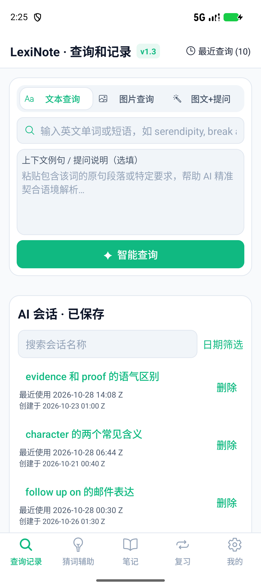 | 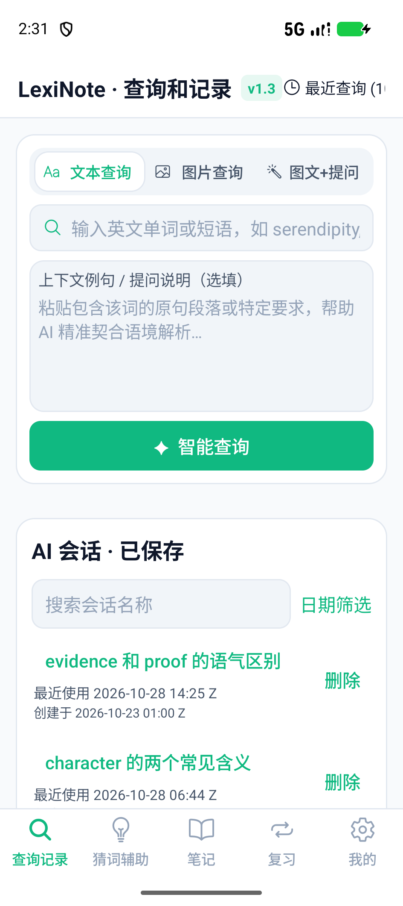 |  |

**LC10：窄屏首页存在实际裁切和挤压。** 360dp时右侧最近查询计数被父容器裁切；320dp时裁切扩大，查询模式文字换成两行，接近36dp固定高度的边缘。标题、版本徽标和最近查询均按内容宽度排列，空间不足时没有合理让位。XML仍可能保留完整text及延伸的节点bounds，因此此项以实际PNG绘制为准。

建议局部调整标题栏：让标题弹性伸缩、将版本徽标移出拥挤区域、把最近查询改为紧凑入口或分行。模式项允许增高或改排，保留用户选择的大字号，不全局缩字。360/320dp是本机修改逻辑视口的受控测试，并非三台实体手机。360dp下[笔记页](layout-comfort/screens/25-notebook-360dp-large.png)和[弹窗](layout-comfort/screens/26-detail-360dp-large.png)仍可操作；弹窗贴边问题继续存在。

### E．阅读与遮挡：浮动动作和颜色需要再检查

| 助手键盘展开 | 配置页键盘展开 |
| --- | --- |
| 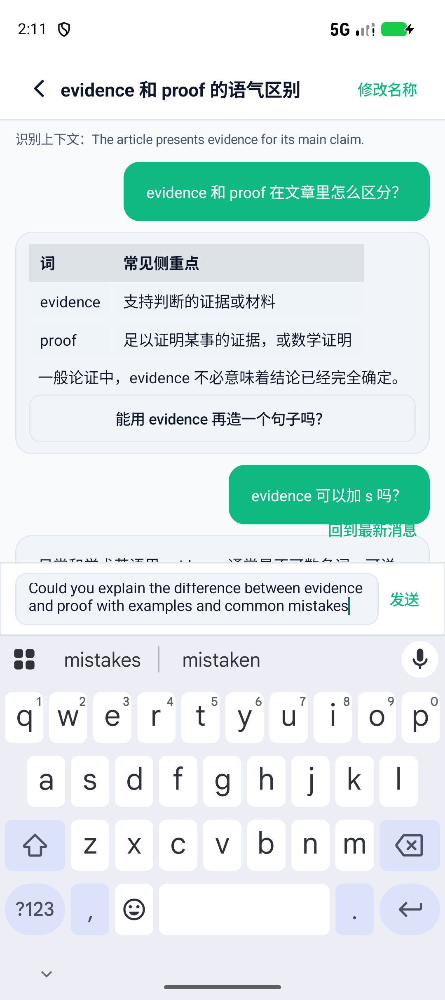 | 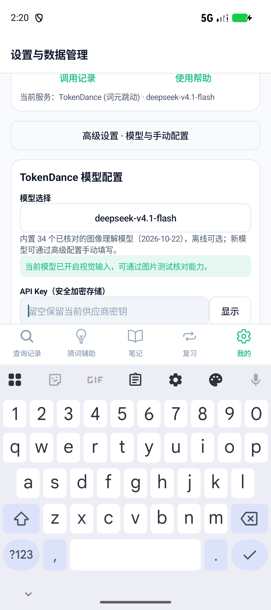 |

**LC11：“回到最新消息”覆盖了消息区域。** 本轮助手键盘图中，按钮叠在绿色用户气泡上，绿色文字与绿色背景局部重合，辨识度下降。此图支持“覆盖用户气泡”，不把旧版本长答案截图误当本轮证据。建议给浮动控件独立、不透明且有对比度的背景，或为它预留不遮挡消息的区域。

键盘展开后助手输入框、发送按钮以及配置密钥输入框仍可见，adjustResize在这些场景有效。配置保存按钮需要继续滚动才能看到，不能写成永久不可达。[360dp首页键盘](layout-comfort/screens/27-home-keyboard-360dp-large.png)也保留取证。本次草稿未发送；未因查看键盘调用API。

**LC12：浅色主色对比偏低。** 默认#10B981与白色的计算对比度约2.54:1，会影响小号绿色文字和白字绿底操作；普通深色正文对比度约17.85:1，阅读基底很好。Google建议小号文字至少4.5:1，大号文字至少3:1。[Android颜色对比说明](https://support.google.com/accessibility/android/answer/7158390?hl=en)。

建议在绿系中为小字和实心按钮选择更深颜色，或使用足够深的文字色；保持强调色的品牌识别。边框#E2E8F0对白色仅约1.23:1，但它多用于装饰分组，不应直接套用文字标准并全局加粗。[本轮深色笔记页](layout-comfort/screens/23-notebook-dark-large.png)的基本文字和分组可读，本轮未把它判成整页不可用。

## 四、建议优化顺序与验收方式

1. **先处理实际可见性与阅读问题：** LC10窄屏响应、LC11浮动遮挡、LC08字号覆盖，以及LC01弹窗留白。改后复查同一条词汇、同一会话和三档视口。
2. **再改善高频点选与浏览：** LC06触控区、LC07横滑发现性、LC04顶部控件层级。保留词卡正文留白，把空间主要从重复操作层中释放。
3. **最后统一视觉规则：** LC09密度档位、LC12主色文字、LC05配置步骤、LC02/03的留白分配。主页、卡片、弹窗分别制定规则，避免一组全局间距值覆盖所有场景。

建议下一轮验收至少满足：360dp与大字号无标题栏裁切；320dp压力场景的模式文字完整；同一段Markdown随应用字号变化；两档密度有可见差异；弹窗标题与正文有一致版心；高频小控件有足够触区；键盘及滚动时浮动按钮不遮挡消息。长词、多义项长例句、系统200%字体和横屏应再补场景。

## 五、测试范围、保留状态与限制

- Pixel_9a模拟器，API37，原始1080×2424、420dpi，约411.4dp逻辑宽度；系统font_scale=1.0。应用字号分别为标准和大（1.15倍）；浅色为主，另检查一张大字号深色笔记页。
- 使用原有80单词、40短语、10最近查询、5临时与8保存会话的样本。覆盖首页文本/图片、笔记列表/详情、助手/键盘/表格、复习首页/揭晓前后、猜词两模式、TokenDance默认/高级/模型选择/键盘。
- 本轮有28组评估画面及1组恢复检查，**29张原始PNG，各有对应XML**；未修图、拼接或让生成模型重绘截图。完整清单及尺寸见[measurements.json](layout-comfort/measurements.json)。正文另明确引用一张同版本前次查询结果图。
- 切换逻辑尺寸至945×2120（360dp）及840×1885（320dp）后已恢复。应用字号、密度、主题、词库、加密服务偏好和回退快照均还原并逐字节比较：[还原结果](layout-comfort/restoration.json)、[数据计数](layout-comfort/restored-state.json)、[恢复后首页](layout-comfort/screens/29-restored-home.png)。仍为120词汇、10最近、5临时、8保存、54消息。
- 没有修改产品代码，没有发送草稿、调用模型、真实拍照或发起登录/充值。本轮评价不等于实体手机的握持、误触率或长时间阅读用户研究；未测所有系统字体、横屏、平板和全部模型名称长度。
- 按仓库要求执行离线testDebugUnitTest、lintDebug、assembleDebug，构建成功；132项JVM测试的通过结果保持有效，lint0错误、13条既有警告；本次50个任务中44个复用缓存。[工程检查日志](layout-comfort/gradle-checks.txt)。工程检查不能代替视觉与交互评估。

测量脚本：[scripts/analyze-layout-comfort.py](../../scripts/analyze-layout-comfort.py)。直接读取原始XML，按420dpi换算dp，并计算颜色对比；“舒适”判断没有包装成虚假的精确评分。

## 附录：本轮原图索引

| 场景 | 原图 |
| --- | --- |
| 首页标准、图片、键盘 | [01首页](layout-comfort/screens/01-home-standard.png)、[04图片](layout-comfort/screens/04-home-image-standard.png)、[05键盘](layout-comfort/screens/05-home-keyboard.png) |
| 笔记与详情标准 | [02列表](layout-comfort/screens/02-notebook-standard.png)、[03详情](layout-comfort/screens/03-detail-standard.png) |
| 助手标准与键盘 | [06助手](layout-comfort/screens/06-assistant-standard.png)、[07键盘](layout-comfort/screens/07-assistant-keyboard-draft.png) |
| 复习 | [08首页](layout-comfort/screens/08-review-overview-standard.png)、[09词卡](layout-comfort/screens/09-review-card-standard.png)、[10答案](layout-comfort/screens/10-review-answer-standard.png) |
| 猜词 | [11图片模式](layout-comfort/screens/11-guess-image-standard.png)、[12文字模式](layout-comfort/screens/12-guess-text-standard.png) |
| 模型与配置 | [13默认](layout-comfort/screens/13-tokendance-standard.png)、[14模型选择](layout-comfort/screens/14-model-picker-standard.png)、[15高级](layout-comfort/screens/15-settings-expanded-standard.png)、[16手动](layout-comfort/screens/16-settings-manual-standard.png)、[17键盘](layout-comfort/screens/17-settings-keyboard.png) |
| 大字号 | [18笔记舒适](layout-comfort/screens/18-notebook-large-comfortable.png)、[19详情](layout-comfort/screens/19-detail-large.png)、[20首页](layout-comfort/screens/20-home-large.png)、[21助手](layout-comfort/screens/21-assistant-large.png) |
| 密度与深色 | [22笔记紧凑](layout-comfort/screens/22-notebook-large-compact.png)、[23深色](layout-comfort/screens/23-notebook-dark-large.png) |
| 360dp大字号 | [24首页](layout-comfort/screens/24-home-360dp-large.png)、[25笔记](layout-comfort/screens/25-notebook-360dp-large.png)、[26详情](layout-comfort/screens/26-detail-360dp-large.png)、[27键盘](layout-comfort/screens/27-home-keyboard-360dp-large.png) |
| 320dp大字号、恢复 | [28压力场景](layout-comfort/screens/28-home-320dp-large-stress.png)、[29恢复](layout-comfort/screens/29-restored-home.png) |
