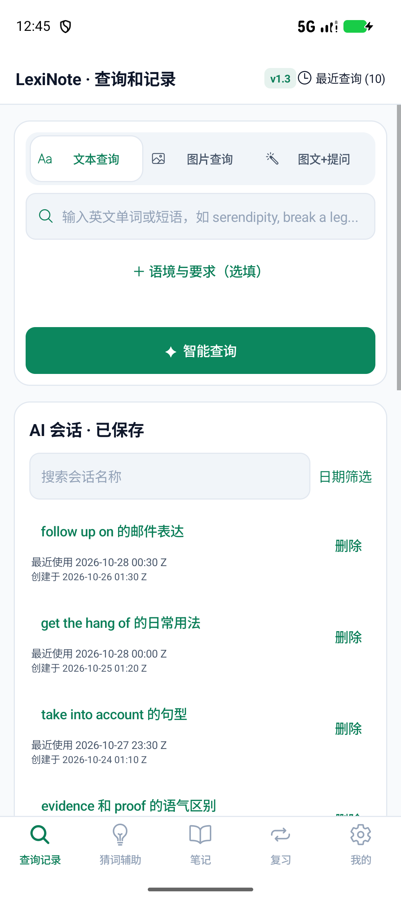
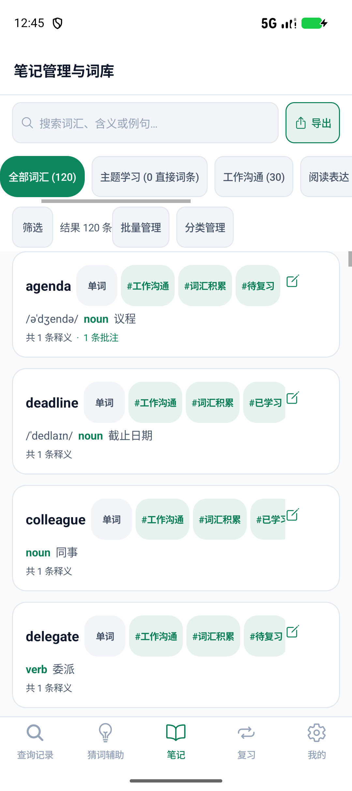
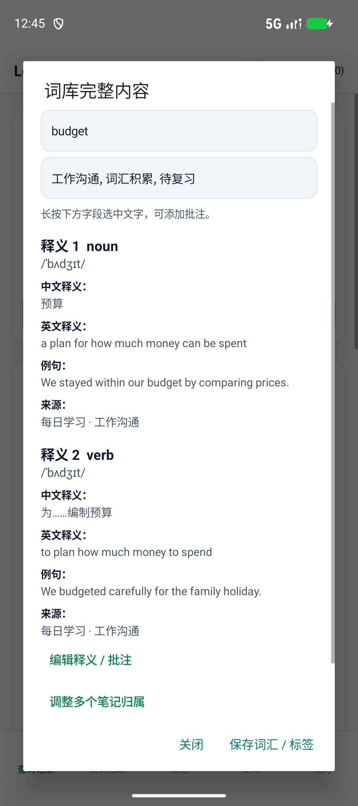
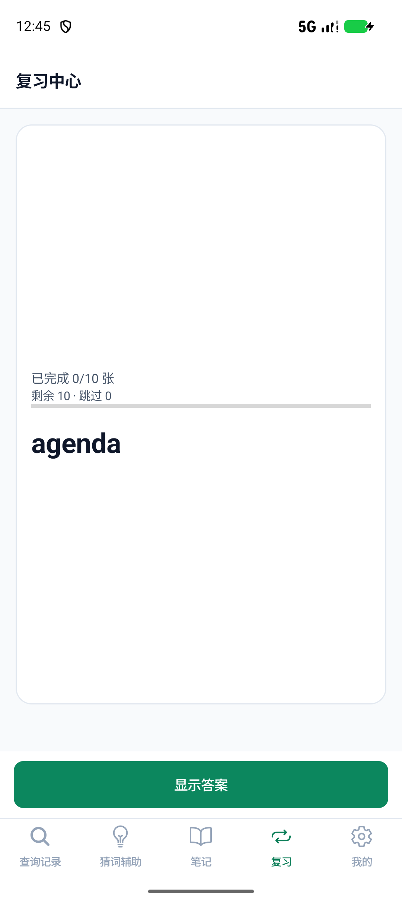
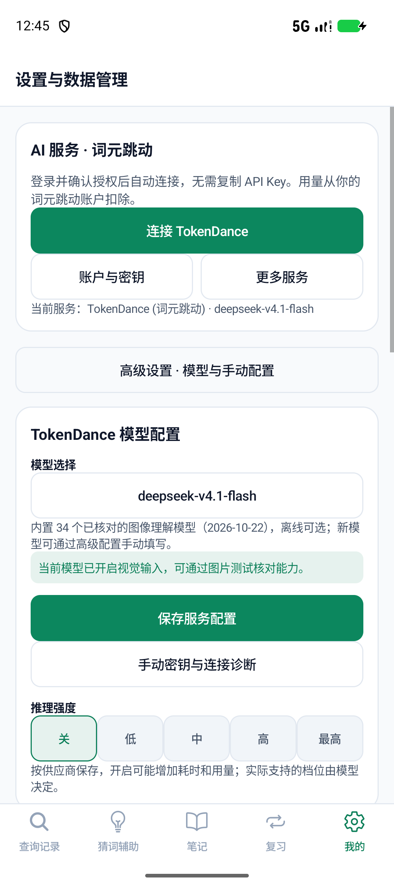
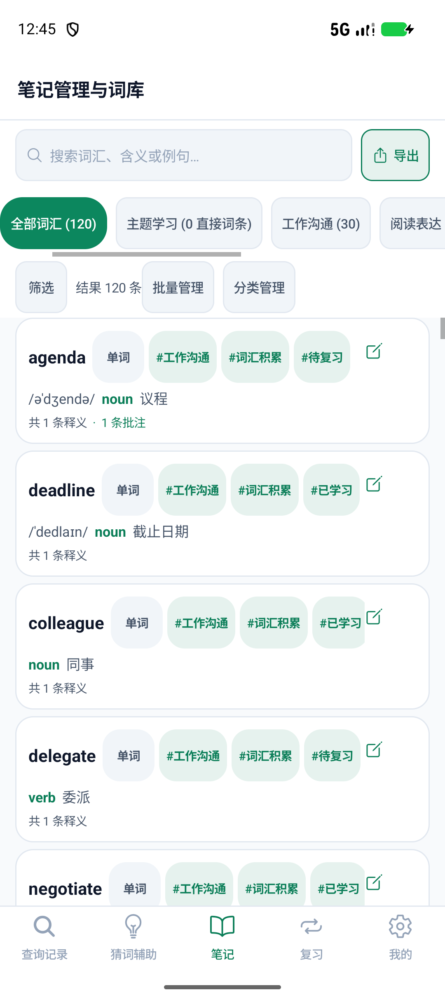
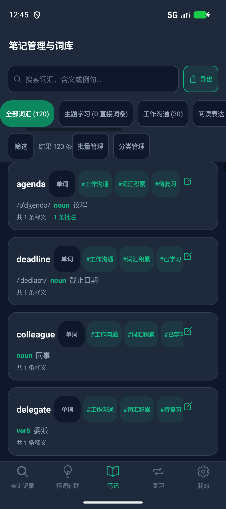

# 页面布局逐项优化与验收

日期：2026-10-29。对象：独立原生 Java 项目；修改前应用版本 b35bd58，上一轮评估文档提交 f2747ef。

## 结果与执行顺序

按[实施计划](../superpowers/plans/2026-10-29-layout-optimization.md)完成 LC01–LC12：先解决触控、阅读与裁切，再调整空间和操作层级，最后处理字号、密度、颜色与不同屏幕组合。三名实现子代理和两名独立复核代理使用 gpt-6.1-terra / high；主代理负责整合和设备验收。

改变的是局部空间分配：保留1dp轻描边，弹窗和卡片增加正文留白；首页折叠选填语境、笔记折叠筛选、TokenDance折叠手动诊断。没有把整个界面统一压紧或统一放大。

## 12项改进对应表

| 类型 | 编号 | 已实施结果 | 验证依据 |
| --- | --- | --- | --- |
| 留白与间距 | LC01 | 词条弹窗正文20dp左右内边距，字段和释义增加分组间隔；长内容继续滚动 | 实际正文边界断言，标准/大字号截图 |
| 留白与间距 | LC02 | 标准字号三个空查询模式均272dp，原为312dp；语境默认折叠，展开增加144dp，草稿及折叠状态保留 | 卡片高度、展开入口、保存状态及原有查询测试 |
| 留白与间距 | LC03 | 复习卡使用可用空间、短内容居中，动作固定底部；长内容按需要滚动 | 卡片/按钮距离、揭晓及评级回归 |
| 密度与层级 | LC04 | 笔记默认三行操作，类型/标签按需展开；筛选按钮固定可见，完整筛选摘要可横滑阅读 | 首条词汇位置、长标签、实时搜索/批量选择 |
| 密度与层级 | LC05 | 默认TokenDance连接及模型选择保留；手动密钥、测试归入独立展开区，充值/记录/帮助归入更多服务 | 默认/展开界面及5组配置回归 |
| 触控与发现 | LC06 | 公共按钮最小宽高48dp，筛选/搜索/日期/编辑/发送等更新对应显式尺寸 | 真实View边界，窄屏检查 |
| 触控与发现 | LC07 | 分类、筛选摘要及复习范围提供常显横滑条；选择后将对应分类/复习范围滚入视区 | 长标签及最右复习范围检查 |
| 适配与设置 | LC08 | Markdown正文、表格和代码使用应用字号，并保留系统字体缩放 | 同一proof表格单元格的实际textSize及200条消息回归 |
| 适配与设置 | LC09 | 舒适/紧凑实际改变卡片内边距16/12dp、卡片间隔16/10dp；触控区不随之缩小 | 相同词库的内边距差异断言和成对截图 |
| 适配与设置 | LC10 | 窄屏标题栏使用短标题、保留最近查询入口；模式栏根据实际字体测量两行高度 | 标题边界、文字行底部边界及4套设备配置 |
| 阅读与遮挡 | LC11 | 回到最新消息移出消息区，使用独立48dp动作行；输入区48–120dp | 按钮与消息矩形不相交，键盘遮挡检查及阅读锚点回归 |
| 阅读与遮挡 | LC12 | 保存的强调色不变，渲染时生成文字/填充变体；公共白字按钮对比度至少4.5，复习熟练度统计文字也按所在背景生成可读绿色，强调文字在卡片上至少5 | 6预设及黑/白/灰自定义色的浅深色单元测试、实际主按钮颜色 |

选图后的图文卡片按内容增高，为“更换/移除”保留至少120dp图片区；应用/系统大字号也可增加卡片高度。因此272dp是标准字号下空模式的基线，不是所有状态的强制上限。

## 改版前后

以下“前”来自上一轮同一样本评估，“后”来自本轮最终安装包；均为模拟器原始截图，没有制作效果图。本轮保留47张最终布局截图（另加还原后首页）；原始失败画面不混作通过证据。所有PNG及日志位于[证据目录](layout-optimization/)。

| 首页：原版选填区常驻 | 首页：默认语境折叠 |
| --- | --- |
|  |  |

| 笔记：原来顶部操作较多 | 笔记：默认三行操作 |
| --- | --- |
|  |  |

| 词条：普通正文贴边 | 词条：20dp内边距及分组 |
| --- | --- |
|  |  |

| 复习：短词和操作距离较远 | 复习：阅读内容居中、底部动作保留 |
| --- | --- |
|  |  |

| 配置：默认动作集中 | 配置：手动诊断按需展开 |
| --- | --- |
|  |  |

## 窄屏、字号与键盘

| 320dp + 应用大字号：首页图文 | 320dp + 应用大字号：助手键盘 |
| --- | --- |
|  |  |

| 舒适密度 | 紧凑密度 |
| --- | --- |
|  |  |

| 深色 | 系统130% + 应用大字号 |
| --- | --- |
|  |  |

这里的大字号不是缩小文字挤入固定区域：模式文字可两行，模式栏按实际字体测量高度；表格保留横向滚动，长标题允许省略显示，详情入口和数据内容保持完整。设置页在大字号下需要向下滚动，这是正常内容增长。

## 回归与复核记录

- **135项JVM测试通过，0失败/错误**；`testDebugUnitTest lintDebug assembleDebug assembleDebugAndroidTest --offline`成功。Lint为0错误、13条既有警告。[构建日志](layout-optimization/integrated-build.txt)。
- 新增布局套件每套**17项通过**：411dp标准、320dp应用大字号、360dp应用大字号、360dp应用大字号叠加系统130%，合计68项设备检查。包括弹窗留白、触控、文字行高、密度、主题截图、键盘、选图及状态保持。[标准](layout-optimization/device-411.txt)、[320dp](layout-optimization/device-320-large.txt)、[360dp](layout-optimization/device-360-large.txt)、[系统130%](layout-optimization/device-360-system130.txt)。
- 原有**32组业务回归通过**：10组Smoke、7组Feature、5组ModelConfiguration、10组Usage。覆盖查询记录/会话保留、批量引用/批注、图片、200条消息/锚点、模拟SSE、模型配置/授权/支付状态以及评级。最终分类目标绑定修正后再次重跑全部32组。[Smoke](layout-optimization/device-SmokeInstrumentation.txt)、[Feature](layout-optimization/device-FeatureInstrumentation.txt)、[配置](layout-optimization/device-ModelConfigurationInstrumentation.txt)、[正常使用](layout-optimization/device-UsageExperienceInstrumentation.txt)。
- 规格复核发现并关闭：语境折叠状态缺少保存、长标签挤走筛选按钮、复习范围重绘滚回左侧、摘要截断。独立质量复核发现并关闭：选图后竖排操作被固定卡高裁切。截图复核另关闭系统大字号下的模式文字裁切。

修复前的失败输出均保留：旧界面[设备失败记录](layout-optimization/device-baseline-red.txt)、[窄屏标题](layout-optimization/header-red.txt)、[复习距离](layout-optimization/review-red.txt)、[状态](layout-optimization/spec-STATE-red.txt)、[长标签](layout-optimization/spec-LONGTAG-red.txt)、[复习范围](layout-optimization/spec-SCOPE-red.txt)、[选图](layout-optimization/image-red.txt)、[系统字号模式裁切](layout-optimization/modes-system130-red.txt)、[复习统计对比度](layout-optimization/metric-contrast-red.txt)。新纯helper最初是缺类编译失败，不等同于原始界面行为失败。

测试设施修正：按钮是否覆盖消息改为检查实际矩形交集（二者具有共同根布局不能据此认定重叠）；Android大系统字号使用非线性字体映射，Markdown按`TypedValue.applyDimension`核对目标字号，不硬套15%的像素比例。本机系统130%下medium=49.35px、large=53.20875px，与Android映射的目标值完全一致。分类菜单测试使用条目实际屏幕坐标点击，避免ListView辅助节点的点击行为造成假象。

额外关闭分类管理的旧目标绑定问题：长按未选中的分类时，删除和新建子分类现在绑定实际目标；长按全部词汇创建分类明确使用根级父节点。3组额外设备检查通过，并断言删除分类不丢失120个词汇实体。[修复前](layout-optimization/manage-target-red.txt)、[根级边界修复前](layout-optimization/manage-root-red.txt)、[修复后](layout-optimization/manage-target-green.txt)。

布局套件使用同一公开正常使用备份，每项重置120词条、8笔记、10最近查询、5临时/8保存会话。设备检查驱动真实Android Views和输入法；这属于可重复的模拟器验收，不能替代真人长期使用评价。

## 交付与保留的设计取舍

设备：Pixel_9a / API37，物理1080×2424、420dpi；窄屏使用wm size覆盖到840×1886（320dp）和945×2121（360dp）。没有改为降低字号来通过测试。

“回到最新消息”独立动作行始终预留48dp，隐藏时不触发消息区域高度变化，以避免阅读锚点跳动。这会占用一行空间；本轮320dp键盘场景仍能阅读消息并操作输入区。分类和长标签使用横向滚动，所有选项可访问，但不承诺同时在首屏全部显示。

未重新验收实体手机、Android8.0、200%系统字号、真实拍照或真实TokenDance支付；本轮没有调用在线模型、登录或付款。上述范围应在后续真机体验阶段继续验证。

本轮完成后恢复测试前词库、加密服务偏好和恢复前快照，并恢复系统字号/屏幕参数；精确恢复结果见[恢复检查](layout-optimization/restoration.json)。新APK路径、大小和SHA256见[APK信息](layout-optimization/apk.json)。APK为同签名调试体验包。

复跑新增检查：构建测试包时加`-PdeviceRunner=com.lexinote.nativeapp.LayoutComfortInstrumentation`，运行`adb shell am instrument -w com.lexinote.nativeapp.test/com.lexinote.nativeapp.LayoutComfortInstrumentation`。窄屏/大字号传`-e large true`；分类目标保护传`-e focus MANAGE`。显示参数须在测试前记录、测试后还原。
