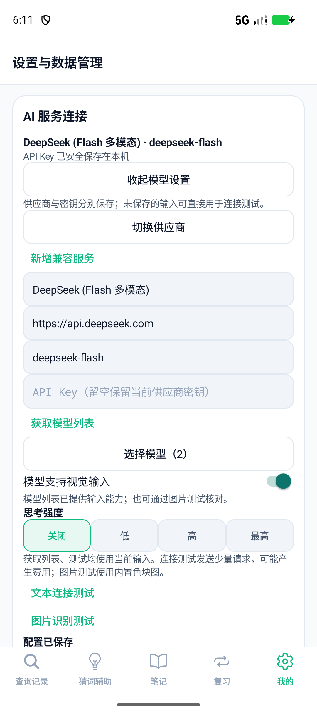
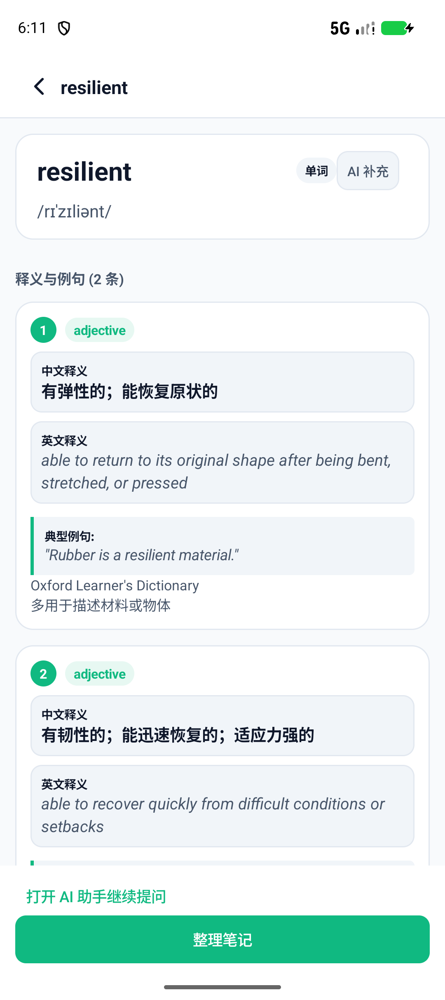
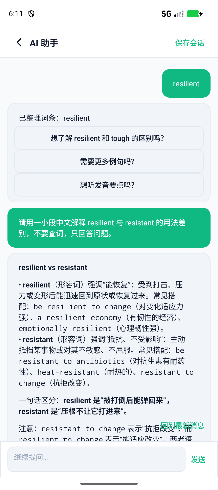

# 模型配置迁移与真实模拟器验收

日期：2026-10-27（Asia/Singapore）。起点070b0bc；原Expo仓库只读。实现/规格审查/质量审查代理均使用 gpt-6-luna/high。

## 已迁移

- 五种源项目预设：TokenDance（手动Key网关）、DeepSeek、OpenAI、SiliconFlow、Moonshot；自定义服务新增、编辑、删除及预设参数恢复。
- 独立供应商ID、地址、模型、视觉开关和思考强度。每个供应商单独AES/GCM加密密钥，旧单配置/密钥原子迁移；兼容旧无名称配置、升级后直接部分保存。空Key保留、明确清除删除；更换目的地址不能静默复用旧Key。
- 当前草稿获取 `/models`，模型搜索/选择或手动ID。读取顶层/嵌套模态与effort元数据，标记能力未知而不推断视觉；按声明显示可用思考档位。公共TokenDance目录无需Key。
- 文本/图片连接探测使用当前输入，不暗中保存。图片是64×64纯色，提示词不透露颜色；需实际答对颜色才成功。请求可取消，无自动重试；错误不包含原始服务端响应或密钥。
- 草稿在普通界面重绘及Activity状态重建时保留非秘密参数，Key不进入Bundle。保存/切换配置保留已发出的后台对话；旧探测回调按代次、供应商ID和草稿版本失效。
- DeepSeek/Kimi/GLM思考开关、Qwen enable_thinking、通用reasoning_effort在查词、猜词和答疑请求中统一使用。官方DeepSeek/OpenAI主机的结构化动作启用JSON输出，标题/连接探测保持文本。

## 实测与回归

| 检查 | 结果 |
| --- | --- |
| JVM | 101项，0失败/错误；包含取消登记竞争、顶层目录能力、视觉提示不泄露答案、JSON请求与历史动作 |
| 构建/Lint | testDebugUnitTest、lintDebug、assembleDebug、测试APK成功；Lint0错误/10警告，无抑制 |
| 模型配置离线设备检查 | 2组通过：旧加密配置迁移/Key隔离/地址保护，以及草稿目录/原生模型选择/探测/显式保存/取消/状态恢复 |
| 原有功能回归 | 7组功能检查+10组Smoke检查通过 |
| DeepSeek真实使用 | Pixel9a/API37中 `https://api.deepseek.com`、`deepseek-flash`：真实列表2项、文本探测、盲测红色色块、配置加密保存、resilient查词、助手比较resilient/resistant追问均通过 |
| 原Expo | lint与tsc --noEmit退出0，工作区无修改 |

证据：[构建](models-gradle.txt)、[配置离线](models-offline.txt)、[真实接口](models-live.txt)、[功能回归](models-features-regression.txt)、[Smoke回归](models-smoke-regression.txt)。

真实接口进行了三轮完整检查。前两轮均通过列表、文本、图片与查词，在追问阶段分别暴露Markdown直出及空JSON；补齐JSON模式、有效JSON示例和历史动作传递后，第三轮五组检查全部通过。没有以放宽动作校验的方式接受无效结果，也没有自动重试收费请求。

## 真实页面截图

配置页中Key输入框为空；测试使用的临时Key未进入源码、截图或结果日志，结束后恢复原有本机配置和本地数据。

| 模型配置 | 查词 | 助手追问 |
| --- | --- | --- |
|  |  |  |

## 复跑

```powershell
.\gradlew.bat --offline testDebugUnitTest lintDebug assembleDebug assembleDebugAndroidTest '-PdeviceRunner=com.lexinote.nativeapp.ModelConfigurationInstrumentation'
adb install -r app/build/outputs/apk/debug/app-debug.apk
adb install -r app/build/outputs/apk/androidTest/debug/app-debug-androidTest.apk
adb shell am instrument -w com.lexinote.nativeapp.test/com.lexinote.nativeapp.ModelConfigurationInstrumentation
```

真实使用可在模拟器内手动输入自己的服务Key。测试入口另支持显式live参数，默认不联网；切勿将Key放在可提交脚本或日志中。测试入口仅存在于androidTest APK，正式应用不包含凭据注入入口。

## 接口依据与边界

实现核对了DeepSeek官方 [模型列表](https://api-docs.deepseek.com/api/list-models/)、[Chat Completions](https://api-docs.deepseek.com/api/create-chat-completion/) 和 [JSON输出](https://api-docs.deepseek.com/guides/json_mode/)。能力随接口返回变化，预设只是可编辑起点。实测使用思考关闭档，其他档位的请求形状由离线用例覆盖；其他供应商、真实手机相机及最低Android版本没有在本轮联网/实机逐一验收。TokenDance账户OAuth/充值付款仍属独立待迁项。供应商本机配置不会随内容备份导出或覆盖。
