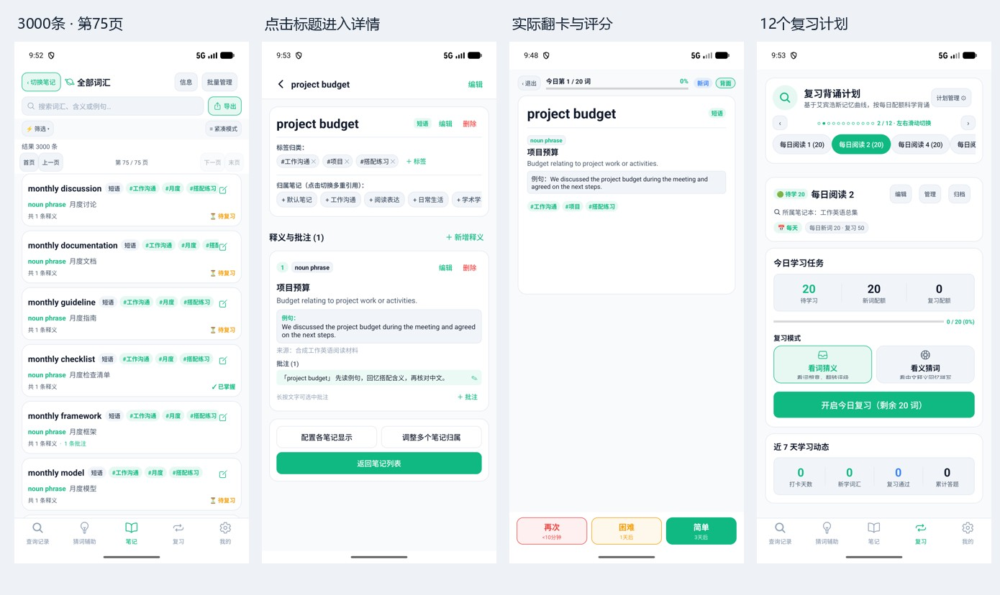

# 大数据实际交互验收（2026-11-01）

已在独立Java仓库 `codex/android-native-java` 构建并安装最新Release APK，导入3000条模拟词汇，完成真实文件选择、点击、键盘输入、翻页、滑动、翻卡评分和冷启动检查。多秒级列表阻塞已修复；评分保存及滚动帧耗时仍有问题，不能宣称整体完全流畅。

## 交付

- [可安装APK](../../releases/lexinote-native-20261101-scale.apk)（1,069,809字节，Release构建，沿用项目测试签名配置）。
- [3000条/12复习计划模拟备份](../fixtures/scale-usage/lexinote-scale-3000-with-plans.zip)。模拟器已导入并保留此样本，实际评分过1条。
- [1000条基础样本](../fixtures/scale-usage/lexinote-scale-1000.zip)及[数据生成说明](../fixtures/scale-usage/README.md)。
- [实机画面拼图](scale-usage/release-contact-sheet.jpg)、[原始操作日志](scale-usage/release-interaction/actions.jsonl)、[APK安装哈希核验](scale-usage/release-interaction/installed-apk.json)。

测试设备为emulator-5554，Android17/API37、x86_64、1344×2992、576MB应用最大堆。没有物理低端手机结果；未访问付费AI服务。本轮不提交或推送GitHub，保留用户原有未提交修改。

## 数据覆盖

两档样本分别1000/3000条唯一词条，均含36个笔记、共享引用、三层笔记树、88个保存会话、5个临时会话、970条消息、单会话600条消息。3000条基础JSON为2,770,811字节，另通过真实业务接口创建12个每日复习计划。

样本为真实结构的合成学习记录，并非真实用户数据；120条原有日常词汇及例句为种子，其余为工作领域组合短语，未经词典逐条审校。没有图片，因此不能据此评估大量高分辨率图片的内存。

## 修复及量化结果

同一模拟器的Debug设备Instrumentation测量。主线程操作结束后等待UI空闲；不是Release宏基准或多次统计分位数。初始两次1000条基线有系统负载波动，以下同时列出范围。

| 操作 | 修复前1000条 | 修复后1000条 | 修复后3000条 |
|---|---:|---:|---:|
| 全部词汇进入到idle |6,273–8,411ms|156ms|231ms|
| 大笔记进入到idle |4,784–8,017ms|109ms|148ms|
| 搜索输入到idle |835–1,369ms|158ms|401ms|
| 复习计划切换到idle |1,157–1,611ms|41ms|48ms|
| 首次生成12个计划任务并显示 |1,195–1,365ms|279ms|767ms|
| 同计划只读重新渲染 |2,060ms|39ms|53ms|
| 实际点击评分到idle |未采集|495ms|1,076ms|
| 本地查词并持久化 |600–604ms|373ms|794ms|
| 单次Repository保存（工作线程） |285–340ms|169ms|442ms|
| ZIP编码 |653–807ms|637ms|1,882ms|

具体改动：

1. `NotebookUi` 原先为每个匹配词条创建卡片，1000条就有1000个正文子View。现每页40条，提供首页/上一页/下一页/末页；过滤和笔记范围改变时重置页码，删除后夹紧页码。搜索、批量全选和导出继续使用完整结果，不截断到当前页。
2. 笔记引用与复习范围检查改用当次构建的ID集合，消除逐词反复扫描全部引用/实体；集合不跨操作缓存，新增、移除引用仍立即生效。
3. 复习新增只读 `hasDailyQueue`，首次生成每日任务后集中保存；页面切换不再无条件重写整份库。评分仍保存后推进。
4. 搜索复用已编译的空白正则，Repository保存只构造一份快照用于验证和写入，减少重复分配。
5. 实际触摸发现紧凑卡片标题被可选择文字截获。标题和类型标签关闭选择后，可点击进入详情；详情正文仍可选择。负向对照重新开启旧选择状态会失败，修复状态通过，返回后保留原筛选范围。

## 实际Release交互

通过Android系统文件选择器选中ZIP，确认「词汇3000 · 笔记36 · 图片0」后恢复。确认书架36本/3000条，点击全部词汇、下一页、末页到第75页，再回首页；使用软键盘输入 `project budget`，结果1条，点击标题进入详情并返回仍保留结果；多次上下滑动列表；点击和横滑12个复习计划，翻卡并实际点击「简单」，第二张显示5%进度。

最终Release启动测得一次冷启动TotalTime846ms（WaitTime851ms）。已安装base.apk的SHA-256与交付APK一致。运行区间的crash buffer及am_anr/am_crash事件未记录本应用崩溃或ANR。[Release日志](scale-usage/release-interaction/)。



## 仍需优化的体验

- **P2：复习评分和本地查询仍同步保存完整JSON。** 3000条评分约1.1秒，本地查询约0.8秒；反复背词时能感觉到等待。下一步应分离词汇、会话和复习进度的持久化，或使用支持事务的增量存储，并在保存成功前保持一致的提交状态。本轮没有将整个存储层改成数据库。
- **P2：连续滚动仍掉帧。** 最终Release仅做10次上下滑动，270帧中128帧被系统标为janky（47.41%），P50=32ms/P95=61ms/P99=85ms；混合页面/键盘场景199帧中99帧janky（49.75%）。这说明分页解决了多秒阻塞，但当前卡片层级和ScrollView绘制仍需优化。模拟器渲染负载会影响比例，尚不能将其全部归因于数据规模；需真机对照和专门trace。不能用功能测试通过推导60fps。[纯滚动原始统计](scale-usage/release-interaction/gfxinfo-scroll-only.txt)。
- **容量限制仍存在。** 文本最高4MiB，长释义/批注/会话会比词条数量更早触及限制，且小堆设备上限可能更低。当前3000条样本约2.64MiB，不代表任意3000条都可导入。设备检查确认超容量保存会抛出明确异常，原文件逐字节不变。
- 最终Release列表滚动后TOTAL PSS约75,390KB，TOTAL RSS约183,236KB，单次读数不构成内存泄漏证明；未覆盖长时间反复切换、海量图片或低内存真机。

官方性能判据参考：[慢渲染](https://developer.android.com/topic/performance/issues/render)、[ANR](https://developer.android.com/topic/performance/issues/anr)。本报告将功能正确性、UI响应耗时和渲染帧表现分开陈述。

## 验证与数据保护

- `testDebugUnitTest lintDebug assembleDebug assembleRelease`：成功。157项JVM测试，0失败/0错误；Lint0错误、27警告，未屏蔽错误。
- ScaleInstrumentation：1000及3000条各11项通过，另1项真实标题触摸回归通过，共23项；覆盖页码、全量选择、搜索、只读复习无写盘、实际评分持久化、600消息留存、离线命中、ZIP回导、超容量保护及无计划空态。
- 设备测试后续使用唯一cache目录的Repository，避免中断时测试库覆盖真实库。开始前原始library、回退快照和加密设置另有主机临时备份；安装最终Release前4个原始文件全部逐字节恢复核验。随后通过用户可见的恢复流程导入样本，因此「我的 → 回到上次恢复前」保留本轮原始120条库。主机原始备份位置仅记录在本地规划文件中，不随公开报告导出。
- 用户已有MainActivity修改逐字节保持，ReviewUi在原有修改上只增量调整任务保存策略，新ReviewPlanPagingTest未改动。独立代码审查及修复复核完成，无未处理的确定性代码回归。

复现命令（PowerShell）：

```powershell
python scripts/create-scale-fixture.py
.\gradlew.bat --offline testDebugUnitTest lintDebug assembleDebug assembleRelease assembleDebugAndroidTest '-PdeviceRunner=com.lexinote.nativeapp.ScaleInstrumentation'
adb install -r app/build/outputs/apk/debug/app-debug.apk
adb install -r app/build/outputs/apk/androidTest/debug/app-debug-androidTest.apk
adb shell am instrument -w -e size 3000 -e mode final com.lexinote.nativeapp.test/com.lexinote.nativeapp.ScaleInstrumentation
adb shell am instrument -w -e size 3000 -e mode title com.lexinote.nativeapp.test/com.lexinote.nativeapp.ScaleInstrumentation
```

完整机器结果：[1000条](scale-usage/scale-final-1000/metrics.json)、[3000条](scale-usage/scale-final-3000/metrics.json)、[测试/Lint汇总](scale-usage/checks.json)。

APK SHA-256：`69e5cbe8e80dde3ce46b43765f88ad98b5b807a8f84f284ccd0f61a7254e4771`。
3000条含计划ZIP SHA-256：`1017f854d600ec36c465ea0f908365be442c8551958b9430e5f32d6ee067adee`。
